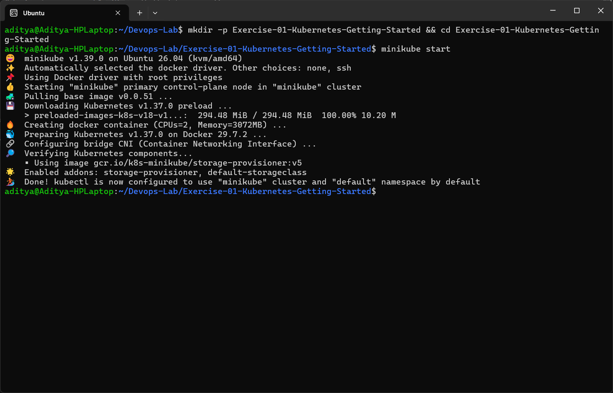
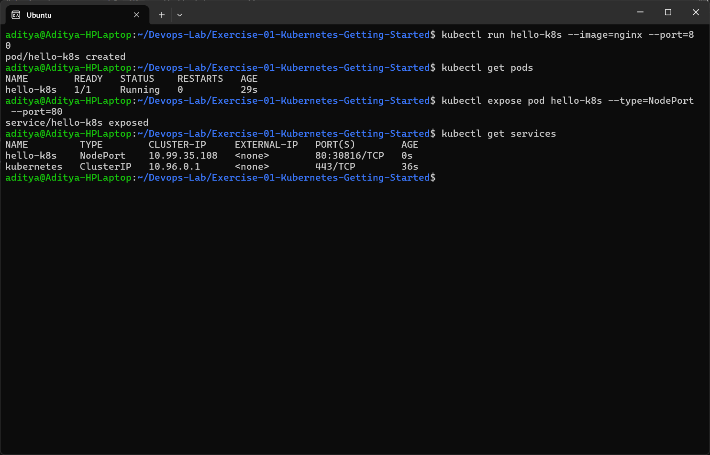
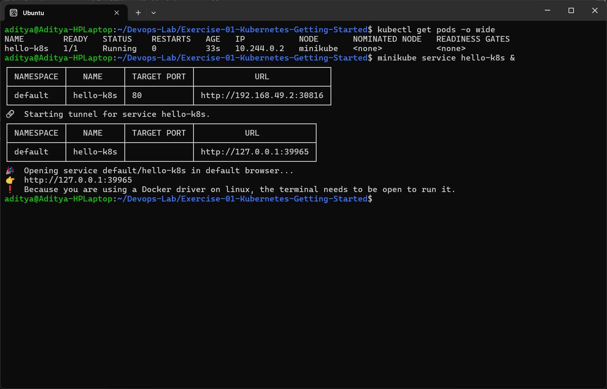
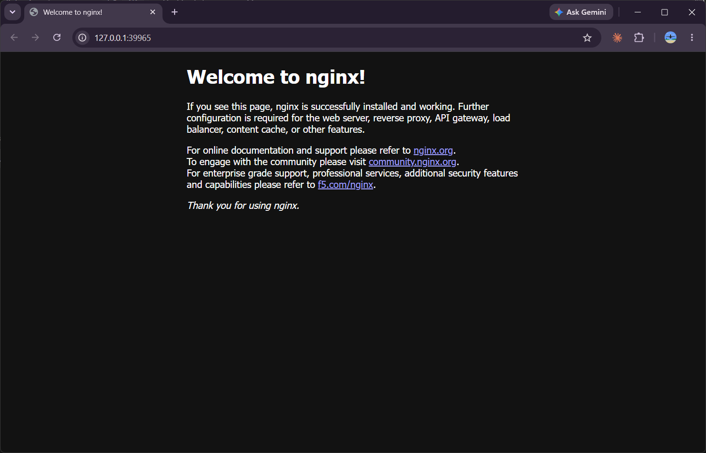

# Exercise 1 - Kubernetes Getting Started (Hello Pod)

## Aim
Run a first application inside Kubernetes using Minikube and access it from the browser.
The `nginx` image is used to simulate the Zepto storefront / delivery status web app.

## Environment
| Tool | Version |
|------|---------|
| OS | Windows 11 + WSL2 (Ubuntu 26.04) |
| Docker Engine | 29.9.2 |
| Minikube | v1.39.0 (docker driver) |
| kubectl | v1.37.1 |
| Kubernetes | v1.37.0 |

## Steps Performed

### 1. Start a local Kubernetes cluster
```bash
minikube start
```


### 2. Create the pod, verify it and expose it as a NodePort service
```bash
kubectl run hello-k8s --image=nginx --port=80
kubectl get pods
kubectl expose pod hello-k8s --type=NodePort --port=80
kubectl get services
```


### 3. Open the app using minikube service
```bash
kubectl get pods -o wide
minikube service hello-k8s
```
Since I am using the docker driver on WSL, minikube creates a tunnel and gives a `127.0.0.1` URL. The terminal has to stay open while the tunnel is running.



### 4. Nginx welcome page in the browser


## Observations
- `kubectl run` created a single pod `hello-k8s` which was scheduled on the `minikube` node.
- `kubectl expose` created a NodePort service (port 80 was mapped to a random node port in the 30000-32767 range).
- `minikube service` opened a tunnel and the nginx welcome page loaded successfully.

## Issue Faced
The latest minikube picked `containerd` as the default container runtime. Exercise 1 worked fine with it, but the next exercise needs `eval $(minikube docker-env)` which only works properly with the docker runtime. So I set the runtime to docker and recreated the cluster:
```bash
minikube delete
minikube config set container-runtime docker
minikube start
```

## Conclusion
Successfully deployed the first container (nginx) on Kubernetes as a Pod, exposed it with a Service and accessed it from the browser.
