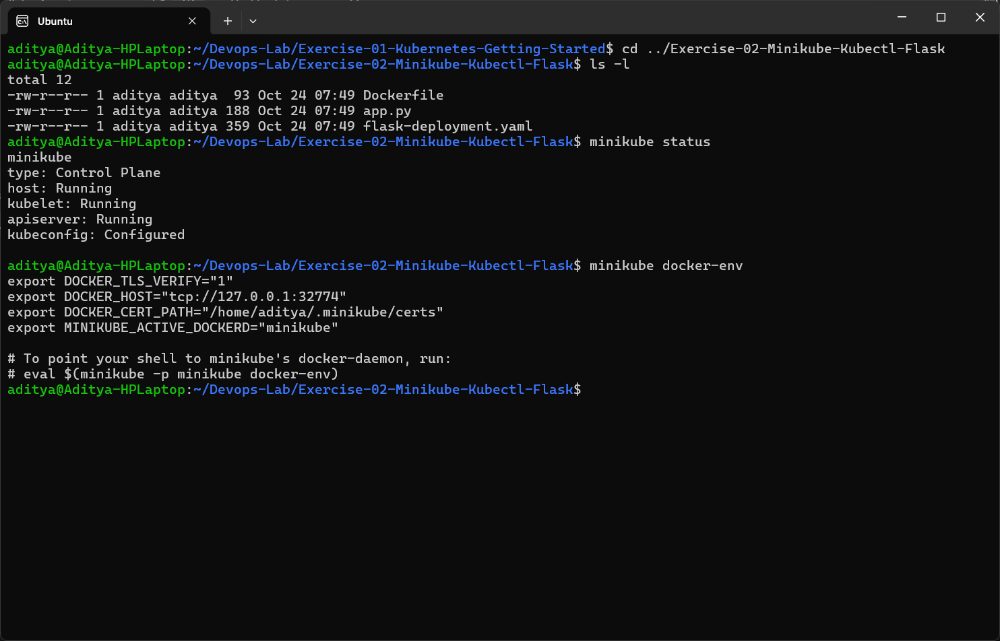
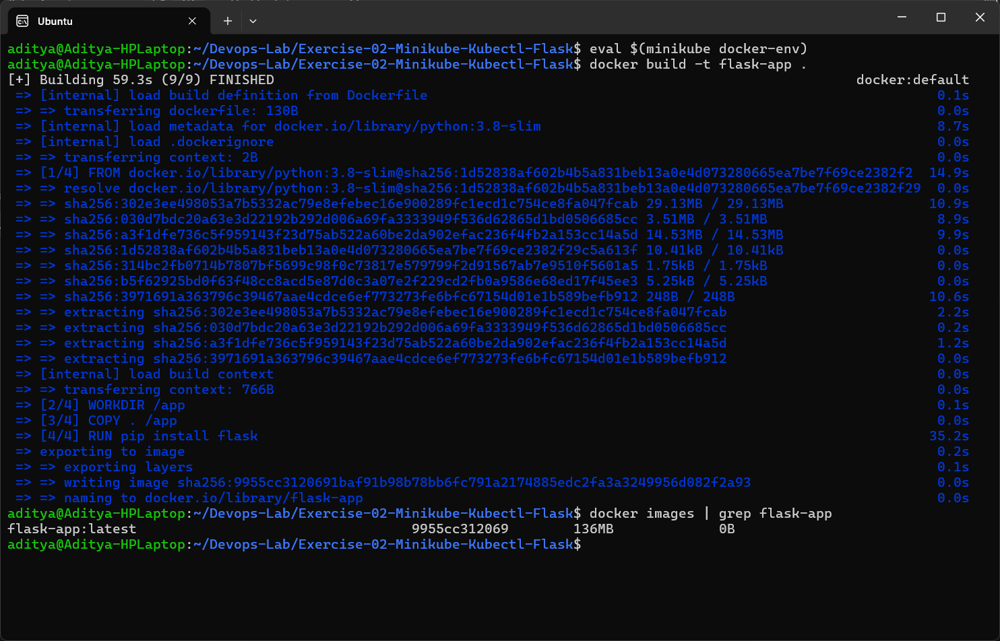
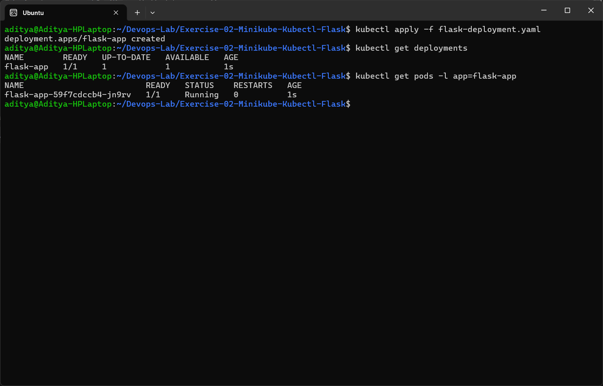
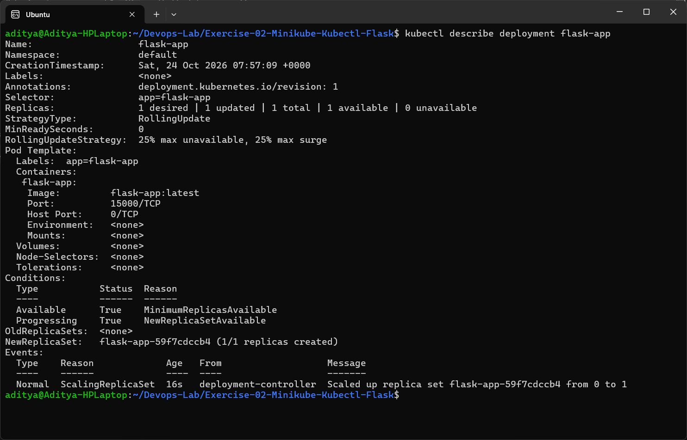
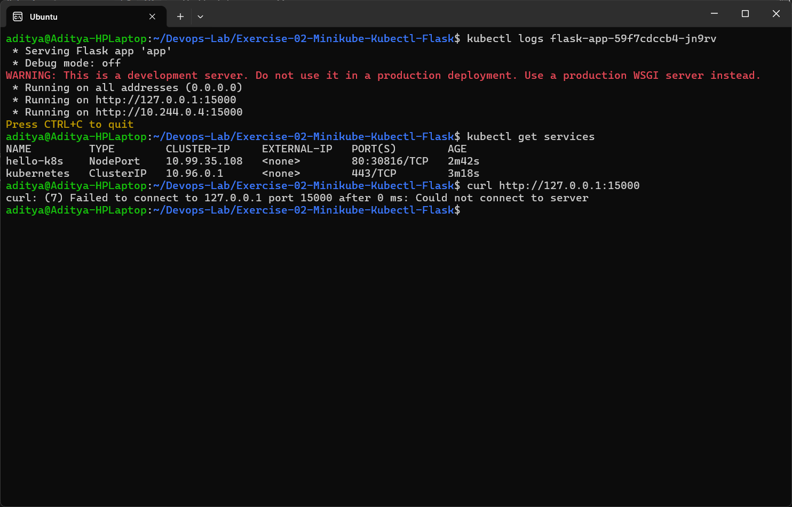
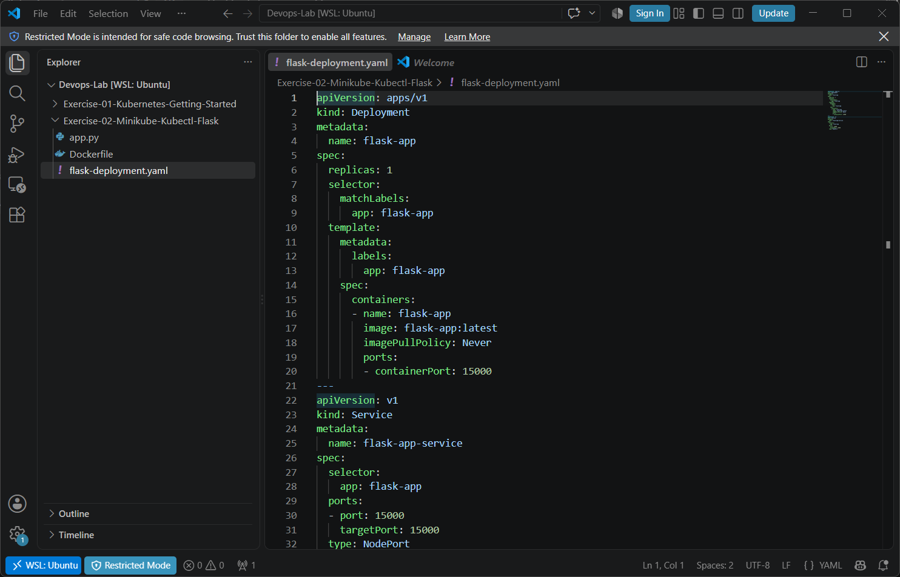
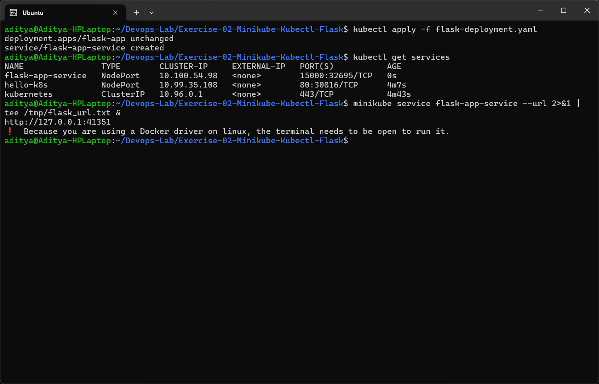
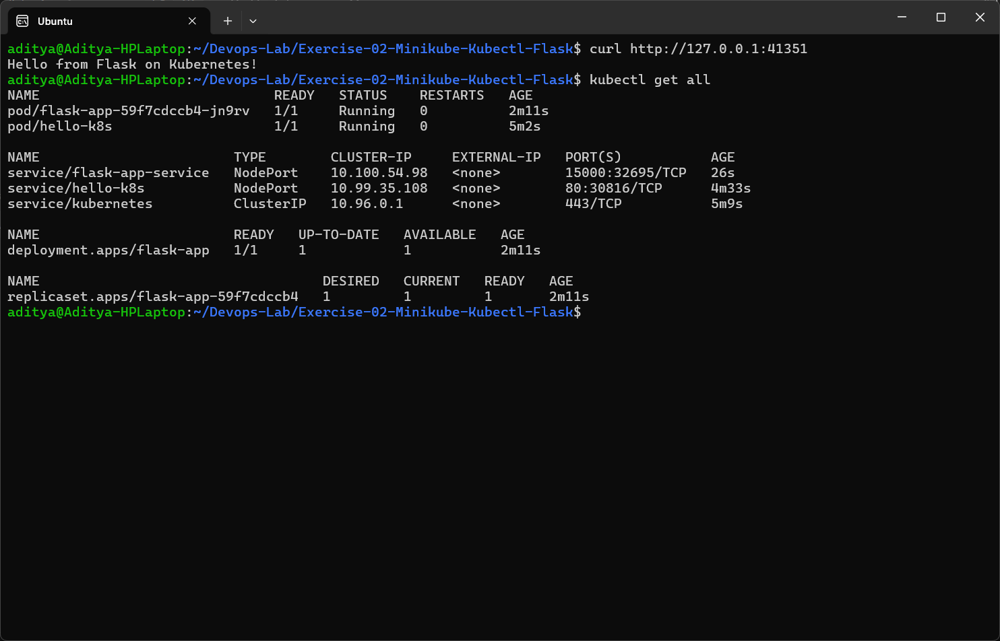
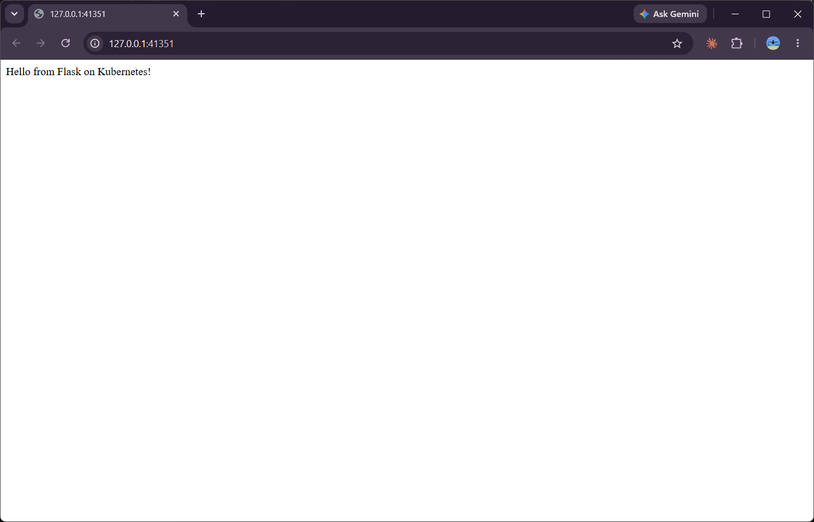

# Exercise 2 - Deploy a Flask App on Minikube using kubectl and YAML

## Aim
Set up a single node Kubernetes cluster with Minikube and deploy a Python Flask application using a Deployment and a Service defined in YAML.

## Files
| File | Description |
|------|-------------|
| [app.py](app.py) | Flask app listening on port 15000 |
| [Dockerfile](Dockerfile) | Builds the `flask-app` image |
| [flask-deployment.yaml](flask-deployment.yaml) | Deployment + NodePort Service |

## Steps Performed

### Step 1 - Check minikube and see the docker-env variables
```bash
minikube status
minikube docker-env
```


### Step 2 - Build the image using Minikube's Docker daemon
```bash
eval $(minikube docker-env)
docker build -t flask-app .
```


### Step 3 - Apply the deployment and check deployment / pods
```bash
kubectl apply -f flask-deployment.yaml
kubectl get deployments
kubectl get pods -l app=flask-app
```
`imagePullPolicy: Never` is used so Kubernetes uses the local `flask-app:latest` image that was built inside minikube instead of trying to pull it from Docker Hub.



### Step 4 - Describe the deployment
```bash
kubectl describe deployment flask-app
```


### Step 5 - Logs, services and trying to access port 15000
```bash
kubectl logs flask-app-59f7cdccb4-jn9rv
kubectl get services
curl http://127.0.0.1:15000
```
The logs show Flask is running on port 15000 inside the pod, but `curl` fails because the app is only exposed inside the cluster (minikube runs in its own container/VM) and there is no Service yet.



### Step 6 - Add a Service section to the YAML
Updated `flask-deployment.yaml` with a NodePort service (`port: 15000`, `targetPort: 15000`).



```bash
kubectl apply -f flask-deployment.yaml
kubectl get services
minikube service flask-app-service --url
```


### Step 7 - Access the Flask app
```bash
curl http://127.0.0.1:41351
kubectl get all
```


Same URL opened in the browser:



## Questions and Answers

**Q1: What is the purpose of `minikube service flask-app-service --url`?**
It gives the URL to access the `flask-app-service` running inside minikube.

**Q2: What happens when you run `minikube service flask-app-service --url`?**
Minikube checks that the service exists and is exposed, creates a tunnel (docker driver) and prints the URL in the terminal.

**Q3: Why is targetPort used in the Service?**
targetPort is the port the container is actually listening on (15000 for our Flask app).

**Q4: Difference between port and targetPort?**
`port` is the port exposed by the Service, `targetPort` is the port of the container the traffic is forwarded to.

**Q5: How do you access a Flask application running in Minikube?**
Expose it with a Service and use `minikube service <service-name> --url` to get the access URL.

**Q6: Why does the terminal need to remain open with the Docker driver?**
With the docker driver minikube runs the tunnel as a foreground process; if the terminal is closed the tunnel stops and the URL stops working.

**Q7: Benefit of the `--url` flag?**
It just prints the URL instead of trying to open a browser, so it is easy to use with curl.

**Q8: What command is used to expose a service in Kubernetes?**
`kubectl expose ...` or `kubectl apply -f <service.yaml>`.

**Q9: How does Minikube help in local Kubernetes testing?**
It runs a single node Kubernetes cluster locally, so deployments can be tested without a real cloud cluster.

**Q10: What is the role of kubectl?**
kubectl is the Kubernetes CLI used to talk to the cluster - deploy apps, scale them, check logs and manage resources.

## Conclusion
The Flask application was containerised, deployed to Minikube using a Deployment and exposed through a NodePort Service. The response `Hello from Flask on Kubernetes!` was received from both curl and the browser.
