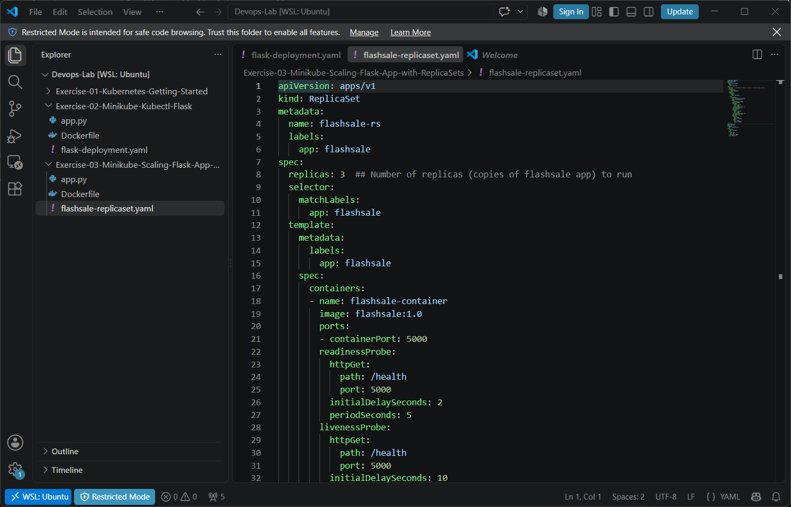
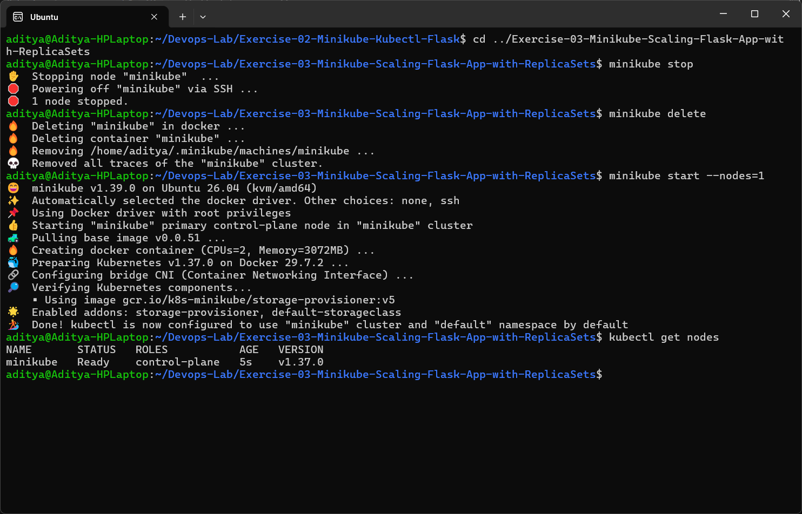
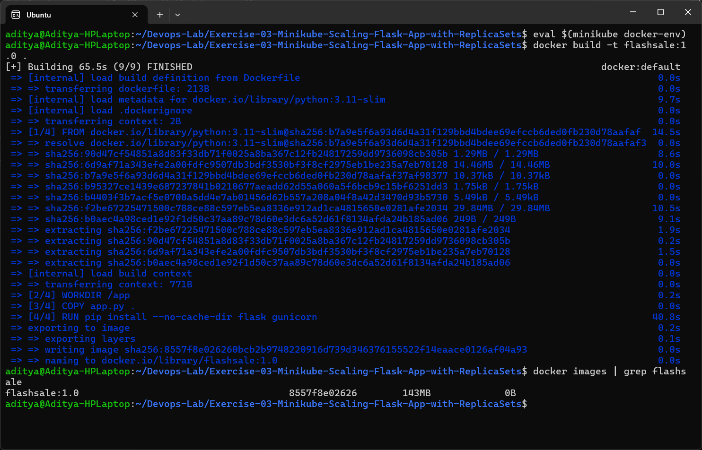
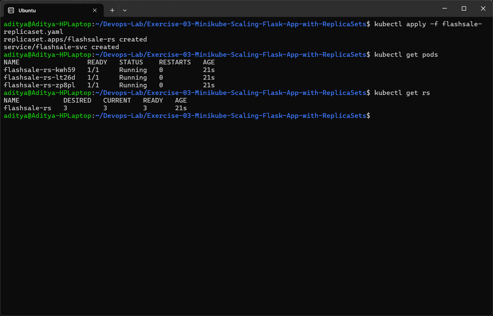
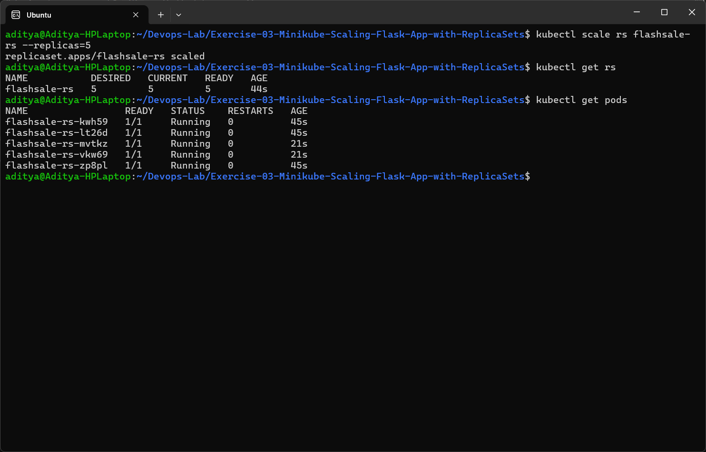
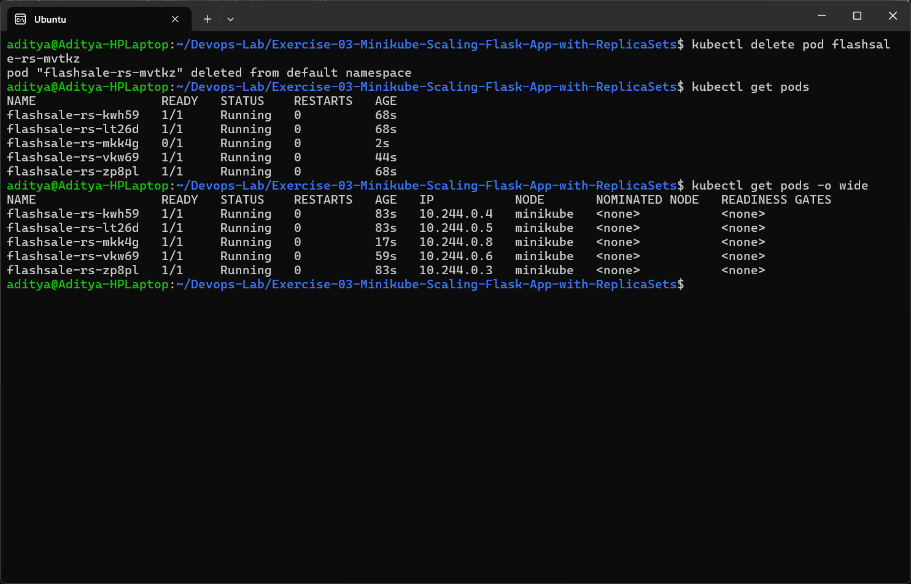
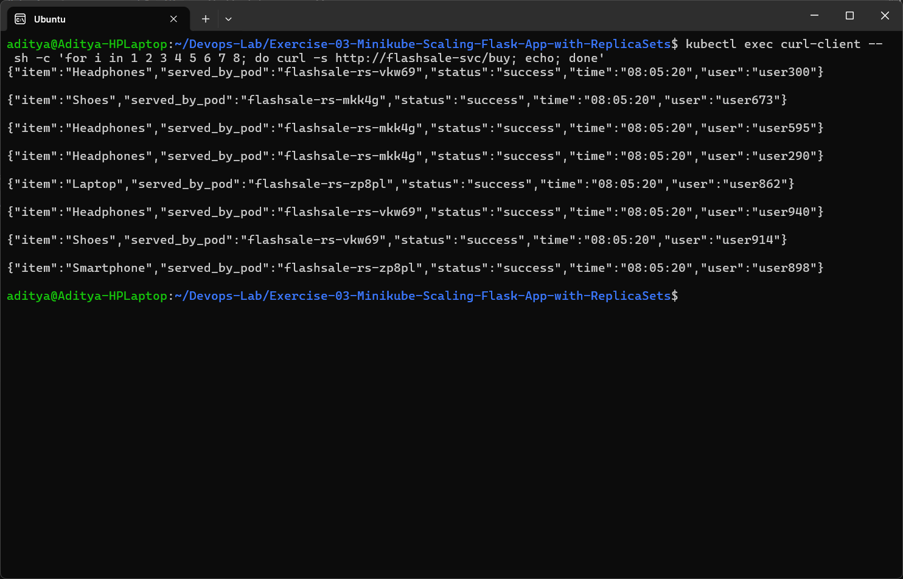
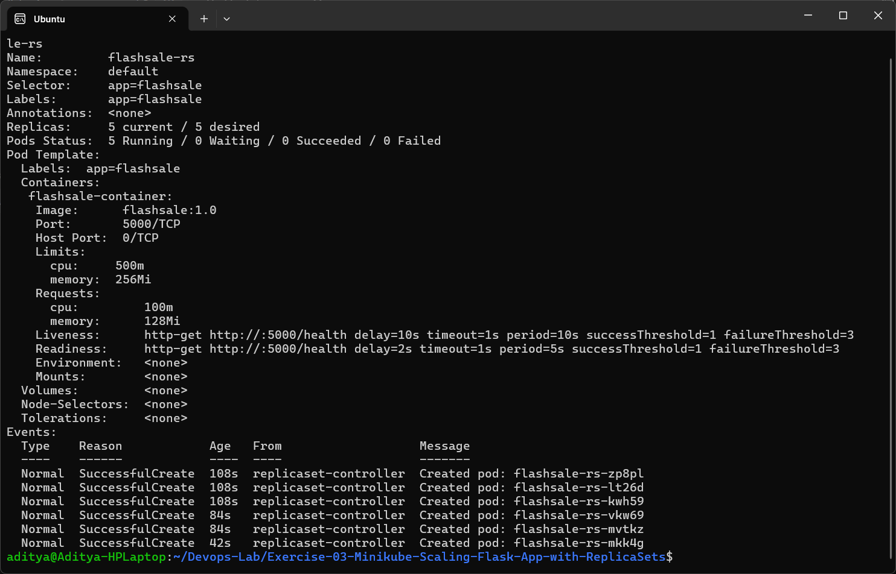

# Exercise 3 - Scaling a Flask App on a Single Node using ReplicaSets

## Use Case
Flash sale on an e-commerce site - traffic suddenly jumps from 100 to 10,000 requests per minute. One pod cannot handle it, so we use a ReplicaSet to run multiple identical pods and scale them up and down.

## Aim
- Understand ReplicaSets and Pods
- Scale the flash-sale Flask app
- Observe self healing and pod distribution

## Files
| File | Description |
|------|-------------|
| [app.py](app.py) | Flash sale API with `/`, `/buy` and `/health` endpoints |
| [Dockerfile](Dockerfile) | Builds `flashsale:1.0` and runs it with gunicorn on port 5000 |
| [flashsale-replicaset.yaml](flashsale-replicaset.yaml) | ReplicaSet (3 replicas) with readiness/liveness probes + ClusterIP Service |



## Steps Performed

### Step 1 & 2 - Clean up old cluster and start a single node cluster
```bash
minikube stop
minikube delete
minikube start --nodes=1
kubectl get nodes
```


### Step 3 - Build the image inside minikube
```bash
eval $(minikube docker-env)
docker build -t flashsale:1.0 .
```
I built the image directly in minikube's docker daemon, so there was no need to push it to Docker Hub. Since the tag is `1.0` (not `latest`) the default pull policy is `IfNotPresent`, so the local image is used.



### Step 4 - Apply the ReplicaSet and verify
```bash
kubectl apply -f flashsale-replicaset.yaml
kubectl get pods
kubectl get rs
```


### Step 5 - Scale the ReplicaSet to 5 replicas
```bash
kubectl scale rs flashsale-rs --replicas=5
kubectl get rs
kubectl get pods
```


### Step 6 - Delete one pod and check self healing
```bash
kubectl delete pod flashsale-rs-mvtkz
kubectl get pods
kubectl get pods -o wide
```
A new pod (`flashsale-rs-mkk4g`) was created immediately to keep the count at 5.



### Step 7 - Send flash sale orders and see which pod served them
```bash
kubectl exec curl-client -- sh -c 'for i in 1 2 3 4 5 6 7 8; do curl -s http://flashsale-svc/buy; echo; done'
```
The `served_by_pod` field changes between requests, which shows the Service is load balancing between the replicas.



### Step 8 - Describe the ReplicaSet (additional challenge)
```bash
kubectl describe rs flashsale-rs
```


## Issues Faced / Changes Made
1. The Dockerfile in the exercise copies `ex3-flash-sale.py` but gunicorn starts `app:app`. I saved the code as `app.py` and used `COPY app.py .` so gunicorn can find the module.
2. The exercise text uses both `flashsale-rs` and `flask-app-rs`. The YAML creates `flashsale-rs`, so I used that name for scale/delete commands.
3. The image has to be built before the ReplicaSet is applied, otherwise the pods go into `ErrImagePull`.

## Questions and Answers

**Q1. What is the initial number of replicas in the ReplicaSet?**
3

**Q2. How many pods are running after applying the ReplicaSet configuration?**
3

**Q3. What happens when you scale the ReplicaSet to 5 replicas?**
Kubernetes creates 2 more pods so that 5 pods are running.

**Q4. What happens when you delete one pod?**
The ReplicaSet controller immediately creates a new pod to replace it, so the count goes back to 5.

**Q5. How does Kubernetes maintain the desired number of replicas?**
The ReplicaSet controller keeps comparing the current number of pods (matching the label selector) with the desired number and creates or deletes pods to match.

**Q6. How many nodes are running?**
1 (`minikube`)

**Q7. Where are the pods running with respect to nodes?**
All 5 pods are running on the single node `minikube` (see `kubectl get pods -o wide`).

## Conclusion
The flash sale app was scaled from 3 to 5 pods using a ReplicaSet. Deleting a pod showed the self healing behaviour, and the `/buy` responses showed requests being spread across the pods.
