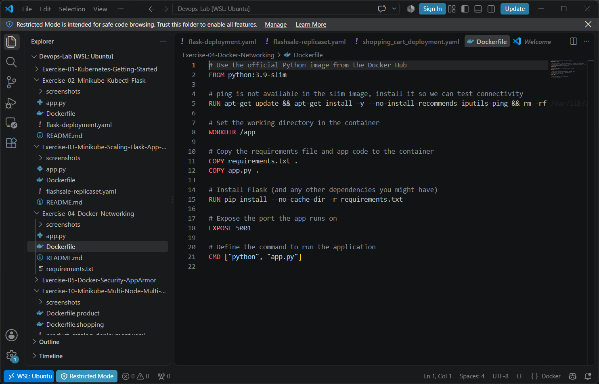
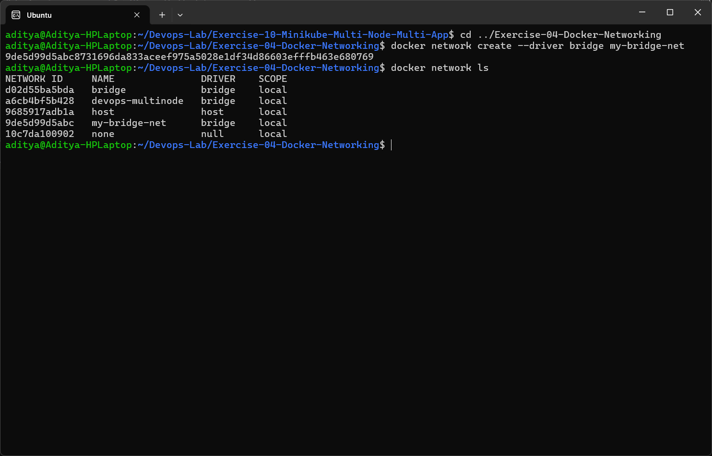
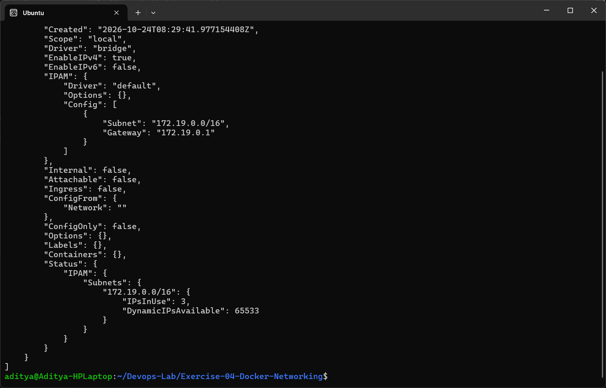
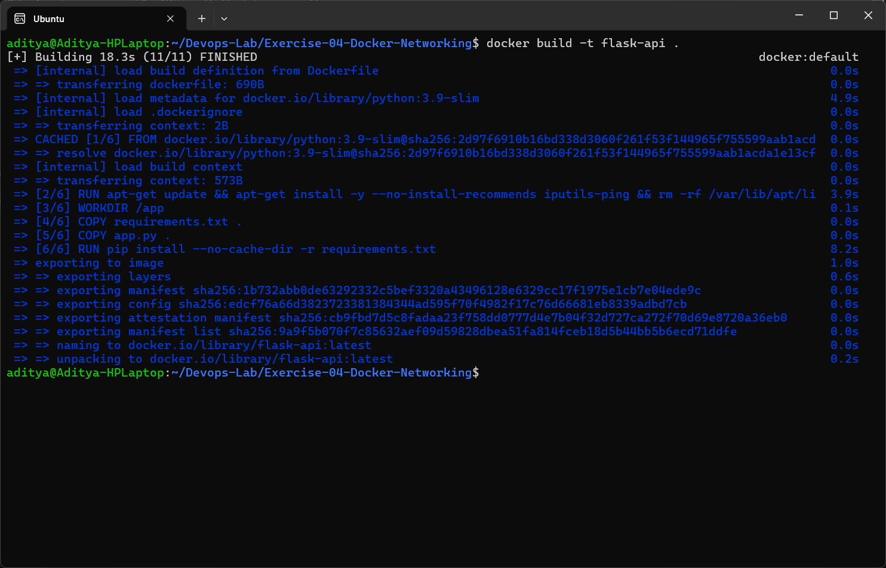
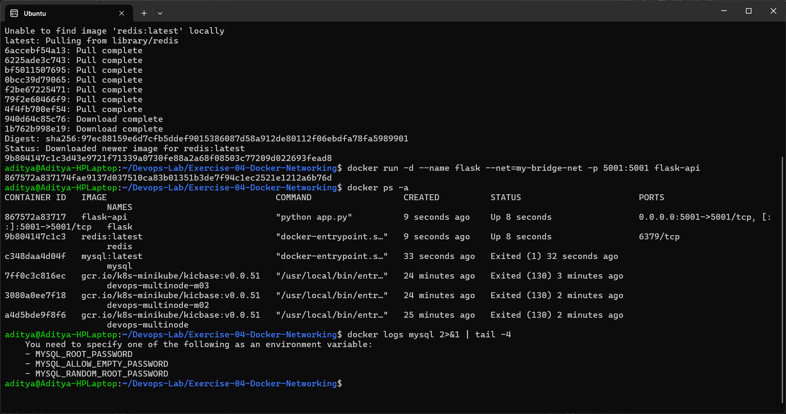
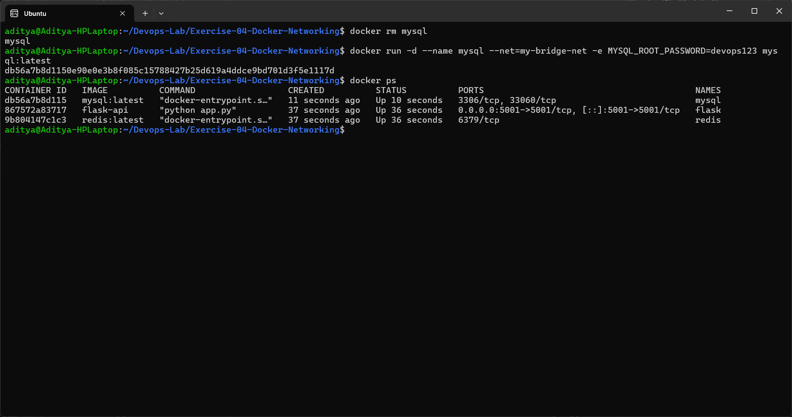
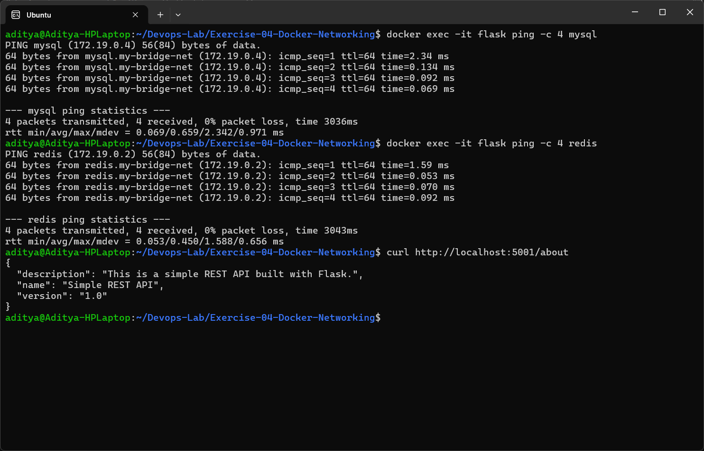
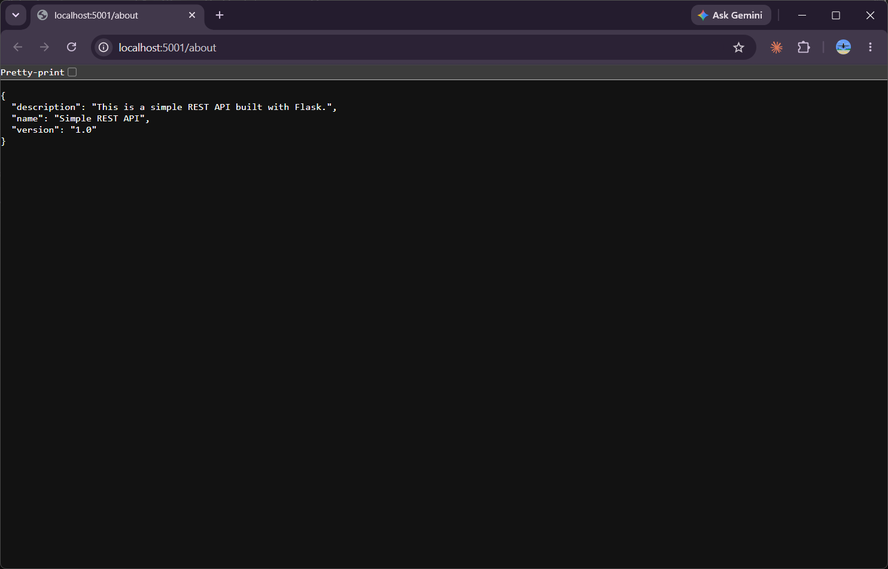
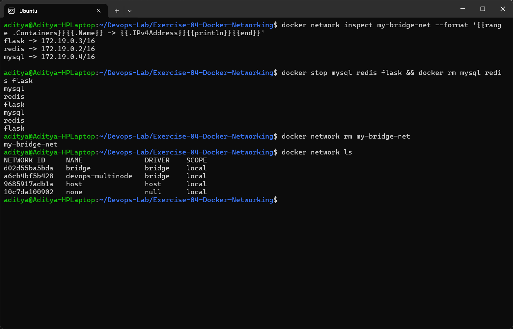

# Exercise 4 - Docker Networking with Multiple Containers

## Aim
Understand Docker networking and connect a multi container application on a user defined bridge network.

## Scenario
A web application made of:
- Python Flask web server (container 1)
- MySQL database (container 2)
- Redis cache (container 3)

## Files
| File | Description |
|------|-------------|
| [app.py](app.py) | Flask REST API with `/about` endpoint on port 5001 |
| [requirements.txt](requirements.txt) | Flask 2.0.1 (+ Werkzeug 2.0.3) |
| [Dockerfile](Dockerfile) | Builds the `flask-api` image |



## Tasks Performed

### Task 1 & 2 - Create a bridge network and verify it
```bash
docker network create --driver bridge my-bridge-net
docker network ls
```


### Task 3 - Inspect the network
```bash
docker network inspect my-bridge-net
```
Docker assigned the subnet `172.19.0.0/16` with gateway `172.19.0.1` (172.17 is the default bridge and 172.18 was already used by minikube).



### Task 4 - Build the Flask image
```bash
docker build -t flask-api .
```


### Task 4 - Launch the containers
```bash
docker run -d --name mysql --net=my-bridge-net mysql:latest
docker run -d --name redis --net=my-bridge-net redis:latest
docker run -d --name flask --net=my-bridge-net -p 5001:5001 flask-api
docker ps -a
docker logs mysql
```
The mysql container exited immediately. The logs show that the MySQL image needs a root password environment variable.



Fixed by passing `MYSQL_ROOT_PASSWORD`:
```bash
docker rm mysql
docker run -d --name mysql --net=my-bridge-net -e MYSQL_ROOT_PASSWORD=devops123 mysql:latest
docker ps
```


### Task 5 - Test connectivity
```bash
docker exec -it flask ping -c 4 mysql
docker exec -it flask ping -c 4 redis
curl http://localhost:5001/about
```
The flask container can reach `mysql` and `redis` just by using the container names - Docker's embedded DNS resolves the names on a user defined network.



API opened in the browser through the published port 5001:



### Task 6 - Clean up
```bash
docker network inspect my-bridge-net --format '{{range .Containers}}{{.Name}} -> {{.IPv4Address}}{{println}}{{end}}'
docker stop mysql redis flask && docker rm mysql redis flask
docker network rm my-bridge-net
```


## Issues Faced / Changes Made
| Problem | Fix |
|---------|-----|
| mysql container exited with code 1 | MySQL needs `MYSQL_ROOT_PASSWORD` (or `MYSQL_ALLOW_EMPTY_PASSWORD`) - added `-e MYSQL_ROOT_PASSWORD=...` |
| `python:3.9-slim` does not include `ping` | Installed `iputils-ping` in the Dockerfile |
| Flask 2.0.1 does not work with the latest Werkzeug 3.x (`url_quote` import error) | Pinned `Werkzeug==2.0.3` in requirements.txt |
| By default `app.run()` listens only on 127.0.0.1 inside the container, so `-p 5001:5001` would not work | Changed it to `host='0.0.0.0'` |

## Questions and Answers

**1. What is the purpose of the `--net` flag in docker run?**
It specifies the network the container should be connected to.

**2. How do containers communicate with each other on the same network?**
Using the container names (Docker DNS resolves them) or their IP addresses on that network.

**3. Difference between a bridge network and a host network?**
A bridge network gives the containers their own private network, isolated from the host, and they talk to each other through the bridge. A host network shares the host's network stack directly, so the container uses the host's IP and ports.
- Bridge: containers are in a private room and talk through a door.
- Host: containers are in the same room as the host and talk to everyone directly.

**4. How can you expose a container's port to the host machine?**
Using the `-p host_port:container_port` flag, e.g. `-p 5001:5001`.

## Conclusion
Three containers (Flask, MySQL, Redis) were connected on a custom bridge network `my-bridge-net`. They could reach each other by name, and the Flask API was exposed to the host on port 5001.
