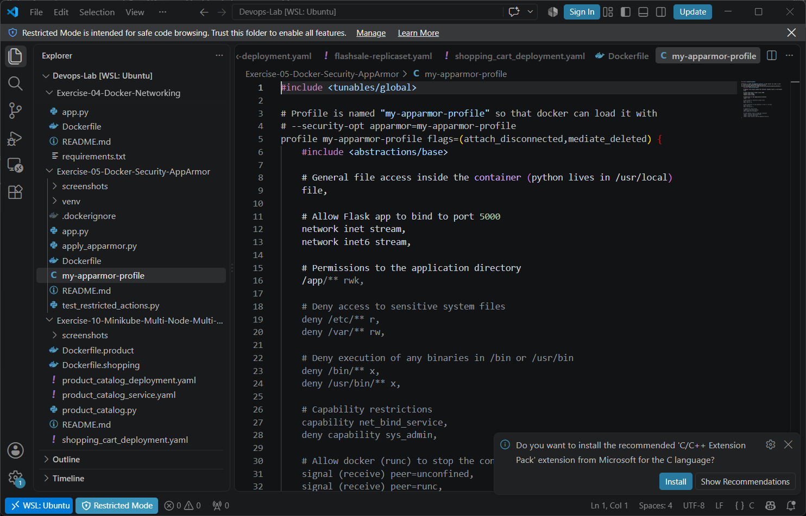
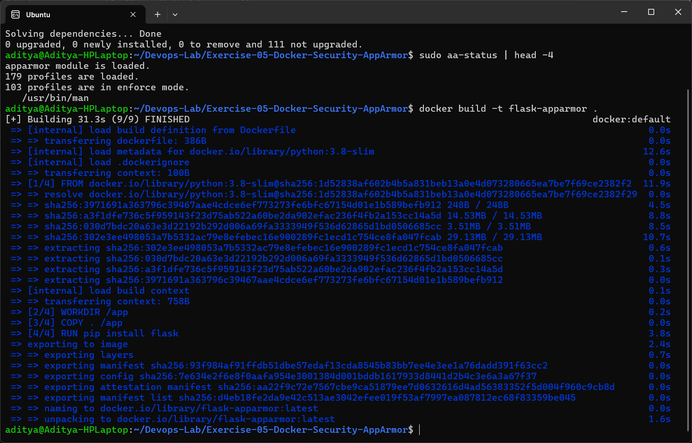
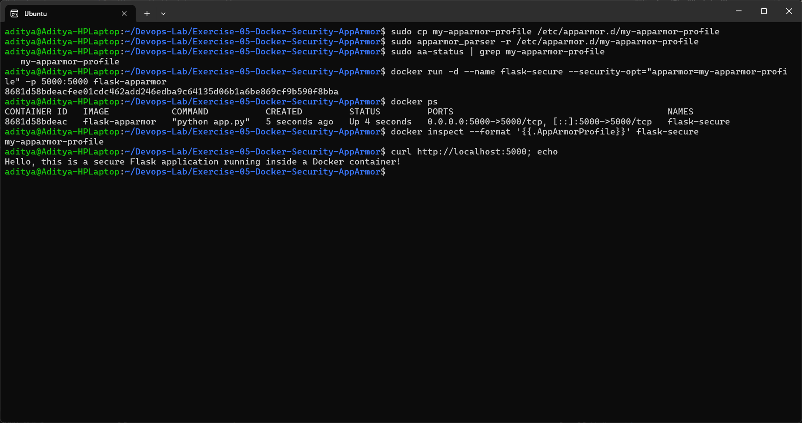
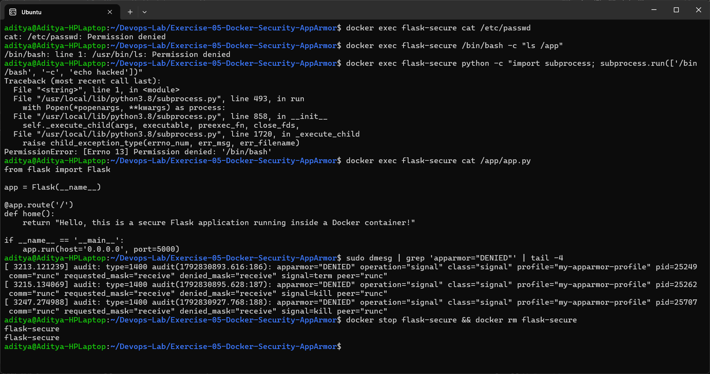
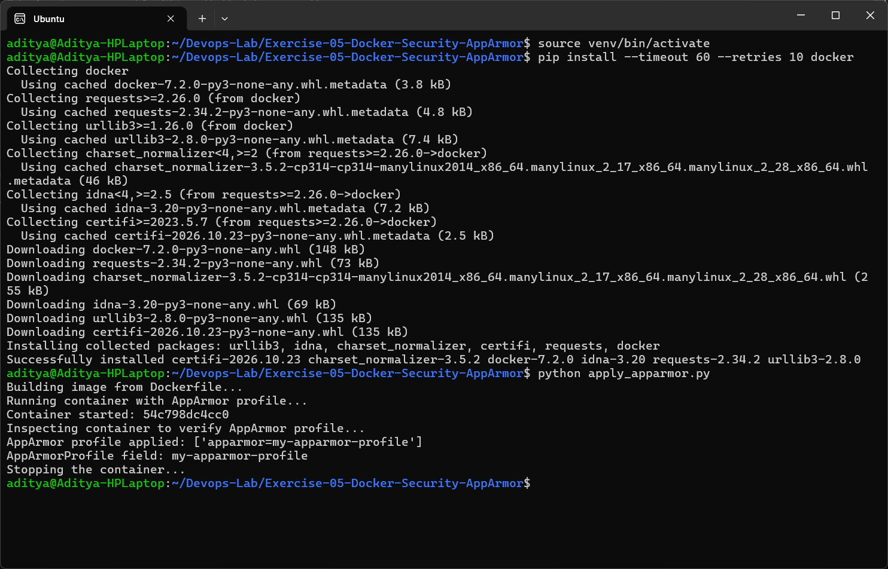
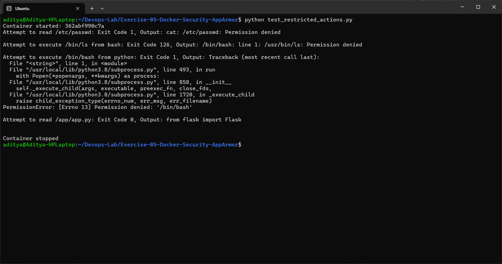

# Exercise 5 - Docker Security with AppArmor and Python

## Aim
Secure a Docker container using an AppArmor profile, apply the profile using the Docker SDK for Python, and test that restricted actions are blocked inside the container.

## Scenario
A Python Flask web app runs inside Docker. It should not be able to read sensitive directories like `/etc` or execute binaries from `/bin` and `/usr/bin`.

## Environment
- WSL2 Ubuntu 26.04 with AppArmor enabled (kernel command line `apparmor=1 security=apparmor` in `.wslconfig`)
- Docker Engine 29.9.2 (inside WSL, so AppArmor is enforced by the same kernel)
- Docker SDK for Python 7.2.0

## Files
| File | Description |
|------|-------------|
| [app.py](app.py) | Flask app on port 5000 |
| [Dockerfile](Dockerfile) | Builds the `flask-apparmor` image |
| [my-apparmor-profile](my-apparmor-profile) | AppArmor profile copied to `/etc/apparmor.d/` |
| [apply_apparmor.py](apply_apparmor.py) | Builds and runs the container with the profile using the Docker SDK |
| [test_restricted_actions.py](test_restricted_actions.py) | Tries restricted actions inside the container |



## Tasks Performed

### Task 1 & 2 - Install apparmor-utils and build the image
```bash
sudo apt-get install -y apparmor-utils
sudo aa-status
docker build -t flask-apparmor .
```


### Task 3 - Create, load and apply the AppArmor profile
```bash
sudo cp my-apparmor-profile /etc/apparmor.d/my-apparmor-profile
sudo apparmor_parser -r /etc/apparmor.d/my-apparmor-profile
sudo aa-status | grep my-apparmor-profile
docker run -d --name flask-secure --security-opt="apparmor=my-apparmor-profile" -p 5000:5000 flask-apparmor
docker inspect --format '{{.AppArmorProfile}}' flask-secure
curl http://localhost:5000
```
The profile is loaded in enforce mode, the container runs with `my-apparmor-profile` and the Flask app still works.



Testing restricted actions manually:
```bash
docker exec flask-secure cat /etc/passwd
docker exec flask-secure /bin/bash -c "ls /app"
docker exec flask-secure python -c "import subprocess; subprocess.run(['/bin/bash', '-c', 'echo hacked'])"
docker exec flask-secure cat /app/app.py
```
- Reading `/etc/passwd` → **Permission denied**
- Running `ls` (`/usr/bin/ls`) → **Permission denied**
- Python trying to start `/bin/bash` → **PermissionError**
- Reading the app directory `/app` → allowed



### Task 4 - Apply the profile using the Docker SDK for Python
```bash
python3 -m venv venv
source venv/bin/activate
pip install docker
python apply_apparmor.py
```
Output shows `AppArmor profile applied: ['apparmor=my-apparmor-profile']`.



### Task 5 - Test restricted actions using Python
```bash
python test_restricted_actions.py
```
| Action | Exit code | Result |
|--------|-----------|--------|
| `cat /etc/passwd` | 1 | Permission denied |
| `/bin/bash -c 'ls /app'` | 126 | `/usr/bin/ls: Permission denied` |
| python → `/bin/bash` | 1 | `PermissionError: [Errno 13]` |
| read `/app/app.py` | 0 | allowed |



## Issues Faced / Changes Made to the Profile
1. **Profile name** - the profile in the exercise is declared as `/usr/bin/python3 { ... }`, so its name is `/usr/bin/python3` and Docker could not find a profile called `my-apparmor-profile`. I declared it as `profile my-apparmor-profile flags=(attach_disconnected,mediate_deleted) { ... }`.
2. **Deny rules with exec modes** - `apparmor_parser` does not accept exec modifiers like `ix` in deny rules, so `deny /bin/** rmix` was changed to `deny /bin/** x`.
3. **Base access** - added `#include <abstractions/base>` and a general `file,` rule, otherwise Python (in `/usr/local/bin`) cannot even start. The deny rules still take priority over `file,`.
4. **docker stop was slow** - at first `docker stop` took 10 seconds and `dmesg` showed `apparmor="DENIED" operation="signal" ... peer="runc"`. The container could not receive SIGTERM from runc, so Docker had to SIGKILL it. Adding `signal (receive) peer=runc,` and `signal (receive) peer=unconfined,` fixed it.
5. **`docker exec <container> /bin/bash` itself is allowed** - Docker attaches the profile while starting that exec, so the first binary is checked against the unconfined policy. Everything started *from inside* the confined process (like `ls` from bash or bash from python) is denied. That is why the test script runs a command through bash/python instead of only running `/bin/bash`.
6. Docker Desktop on Windows does not enforce AppArmor, so I ran Docker Engine directly inside WSL with AppArmor turned on.

## Questions and Answers

**1. What is the purpose of using AppArmor with Docker containers?**
AppArmor enforces security policies that limit what a containerised application can access (files, network, capabilities). It is an extra layer of security on top of normal container isolation.

**2. How do AppArmor profiles help secure a Docker container?**
The profile defines what the container can and cannot do - which paths it can read/write, which binaries it can execute, network access and capabilities. Even if the app is compromised, the attacker is limited to what the profile allows.

**3. Why restrict access to `/etc/` and `/var/`?**
`/etc` has configuration and user information (like `/etc/passwd`) and `/var` has logs and application data. Blocking them stops the container from reading or changing important system files.

**4. What other capabilities can you restrict using AppArmor?**
Network access (tcp/udp, raw sockets), binding to ports, executing binaries, writing to specific directories, mounting, ptrace/signals between processes, and Linux capabilities like `sys_admin`, `net_admin`, `sys_ptrace`.

**5. How can you verify that an AppArmor profile is applied to a container?**
- `docker inspect --format '{{.AppArmorProfile}}' <container>`
- `HostConfig.SecurityOpt` using the Docker SDK (`client.api.inspect_container`)
- `cat /proc/1/attr/current` inside the container shows `my-apparmor-profile (enforce)`
- `sudo aa-status` on the host

## Conclusion
A custom AppArmor profile was loaded and applied to the Flask container both with the Docker CLI and the Docker SDK. Reading `/etc/passwd` and executing binaries from `/bin` / `/usr/bin` were blocked, while the Flask app and the `/app` directory continued to work.
