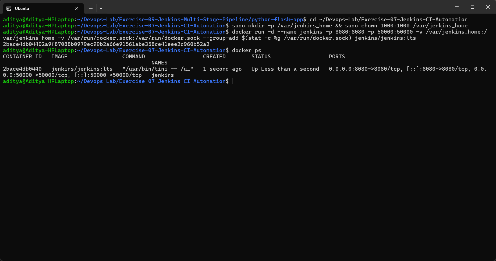
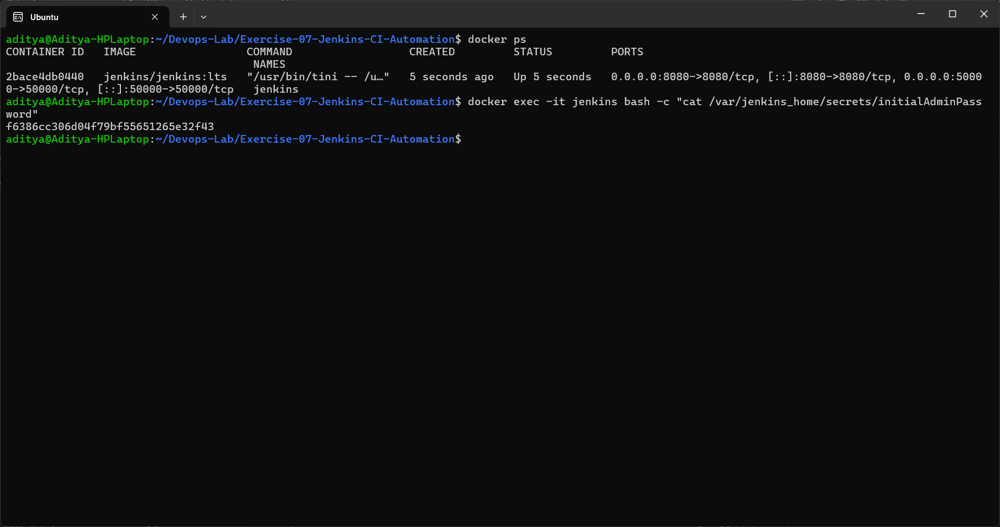
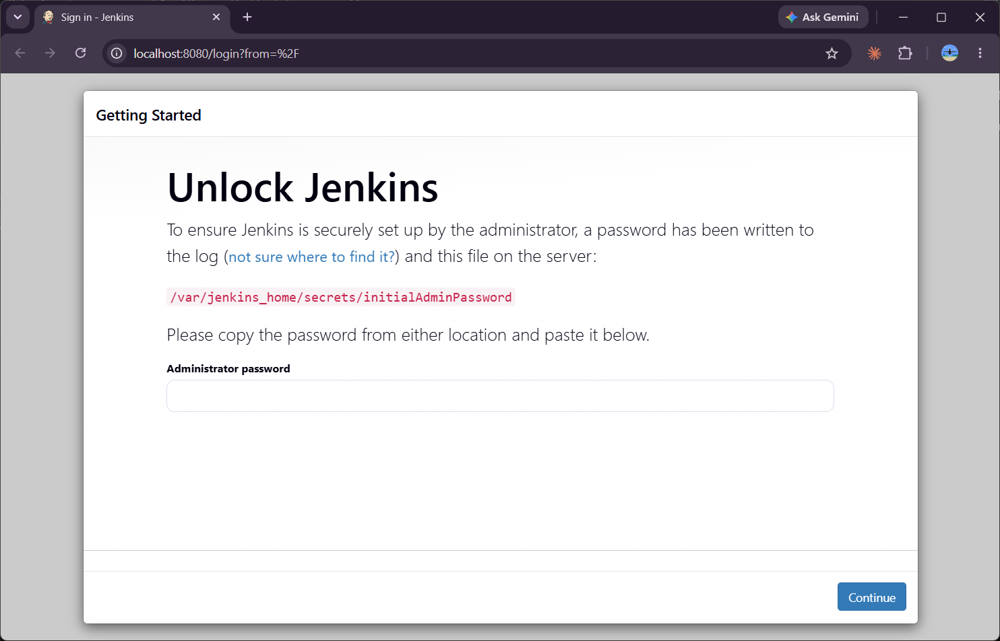
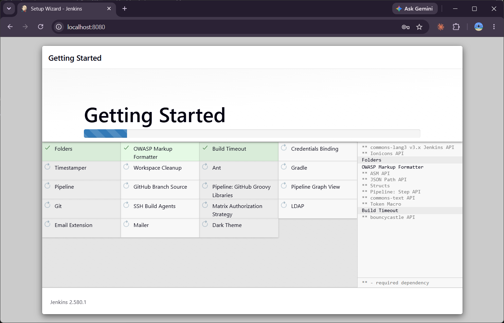
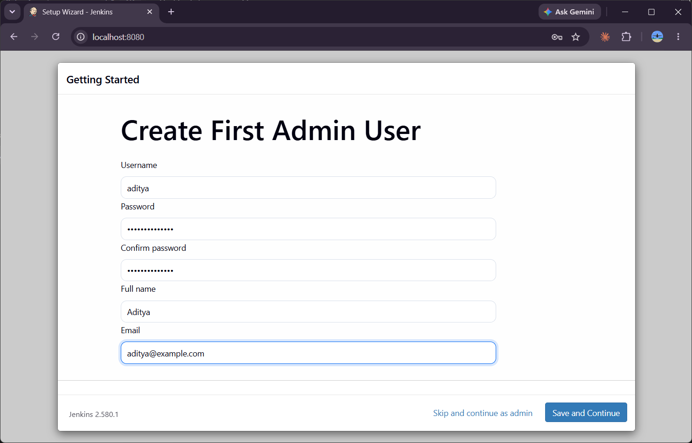
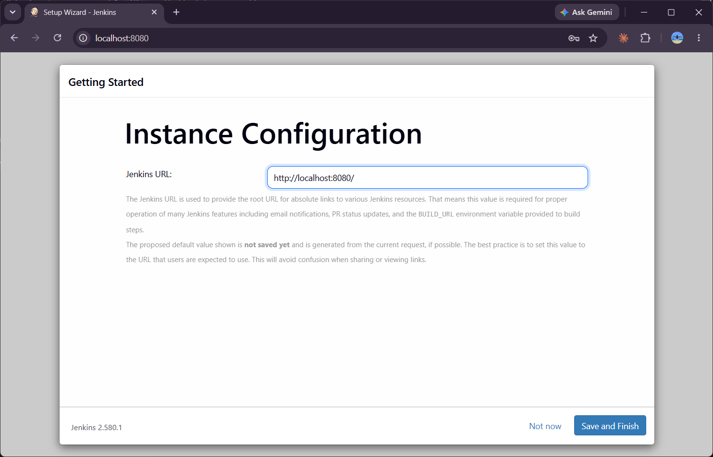
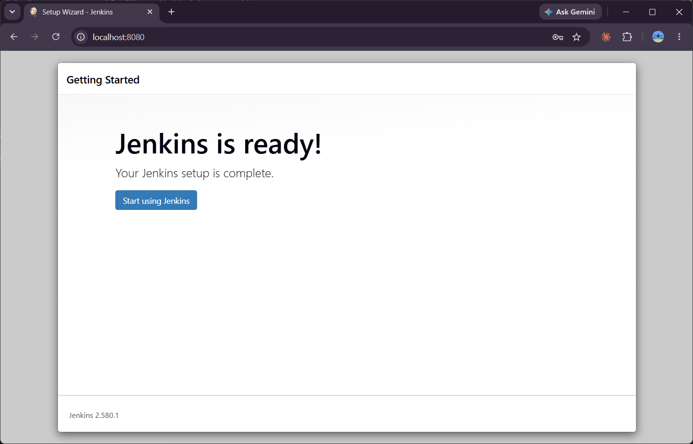
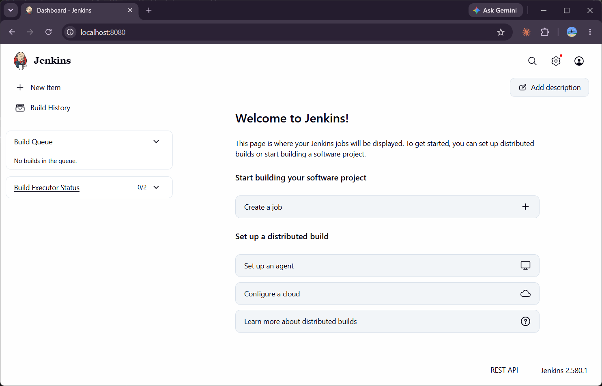

# Exercise 7 - Introduction to Continuous Integration (CI) and Jenkins Installation

## What is Continuous Integration?
Continuous Integration (CI) is a practice where developers merge their code changes into a shared repository frequently (many times a day). Every change triggers an automated build and tests, so integration problems and bugs are found early instead of at the end.

### Key features of CI
1. **Frequent code integration** - small changes are committed often.
2. **Automated builds** - every commit is built automatically.
3. **Automated testing** - unit/integration tests run as part of the build.
4. **Immediate feedback** - developers quickly know if their change broke something.

### Benefits
- Early bug detection, so bugs are cheaper to fix
- Better collaboration on a shared codebase
- Faster development cycles
- Higher code quality and fewer regressions

### How CI works
```
Developer pushes code --> CI server detects change --> Build --> Run tests --> Feedback (pass / fail)
```

### Popular CI tools
| Tool | Notes |
|------|-------|
| Jenkins | Open source, self hosted, huge plugin ecosystem |
| GitHub Actions | YAML workflows built into GitHub |
| GitLab CI/CD | Built into GitLab, YAML pipelines, Auto DevOps |
| CircleCI | Cloud based, container based execution |
| Travis CI | Popular with open source projects |
| Bamboo | Atlassian, integrates with JIRA and Bitbucket |
| TeamCity | JetBrains, detailed build history and reports |
| Azure DevOps Pipelines | Microsoft, integrates with Azure |
| Spinnaker | Continuous delivery, multi-cloud deployments |
| Buildkite / Drone | Hybrid / container based pipelines |

## Introduction to Jenkins
Jenkins is an open source automation server used to build, test and deploy software. It supports CI/CD through jobs and pipelines and can be extended with plugins.

**Key concepts:** Job/Project, Build, Pipeline, Plugins, Nodes (controller/agents).

## Installing Jenkins using Docker

### Step 1 - Run the Jenkins container
```bash
sudo mkdir -p /var/jenkins_home && sudo chown 1000:1000 /var/jenkins_home
docker run -d --name jenkins -p 8080:8080 -p 50000:50000 \
  -v /var/jenkins_home:/var/jenkins_home \
  -v /var/run/docker.sock:/var/run/docker.sock \
  --group-add $(stat -c %g /var/run/docker.sock) \
  jenkins/jenkins:lts
```
- `-p 8080:8080` - web UI
- `-p 50000:50000` - agent communication port
- I added a bind mount for `/var/jenkins_home` (so jobs are kept even if the container is recreated) and the Docker socket, because the pipeline in Exercise 6 needs to run `docker` commands from Jenkins.



### Step 2 - Get the initial admin password
```bash
docker ps
docker exec -it jenkins bash -c "cat /var/jenkins_home/secrets/initialAdminPassword"
```


### Step 3 - Open http://localhost:8080 and unlock Jenkins


### Step 4 - Install suggested plugins


### Step 5 - Create the first admin user


### Step 6 - Instance configuration (Jenkins URL)


### Step 7 - Jenkins is ready


### Step 8 - Jenkins landing page (dashboard)


## Conclusion
Learned the basics of Continuous Integration and the common CI tools, and installed Jenkins (2.580.1 LTS) in a Docker container with the suggested plugins. This Jenkins instance is used for Exercises 8, 9 and 6.
