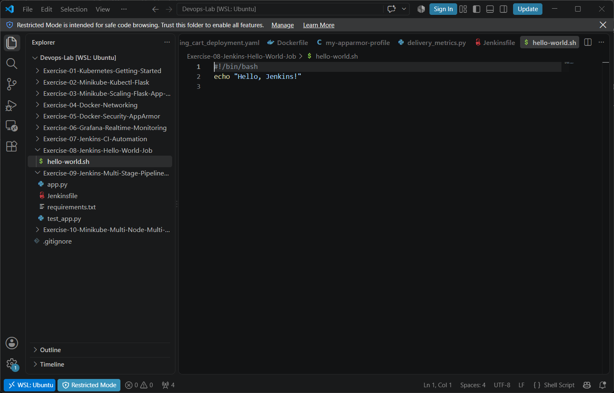
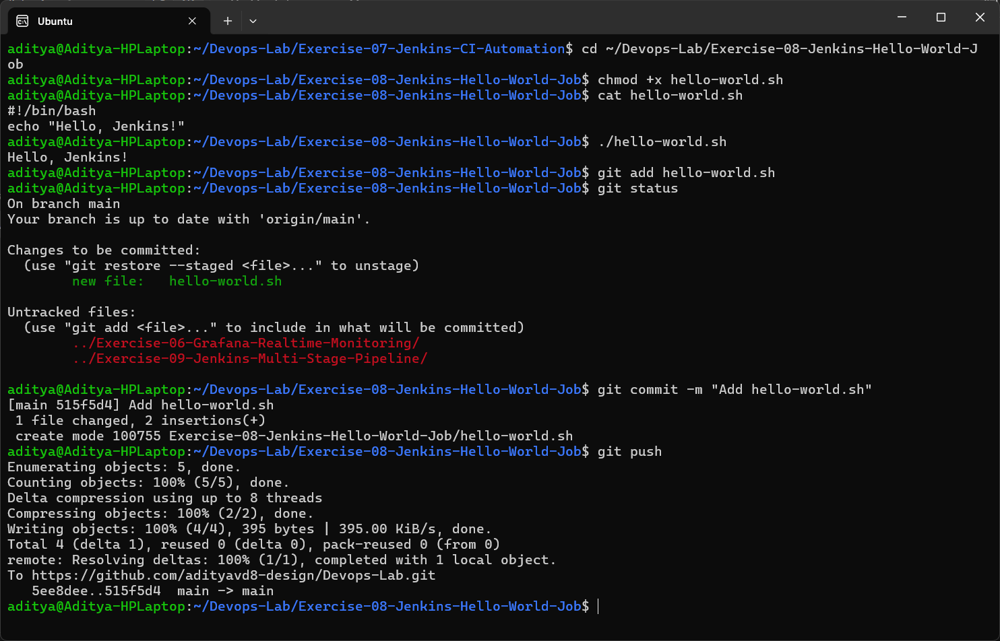
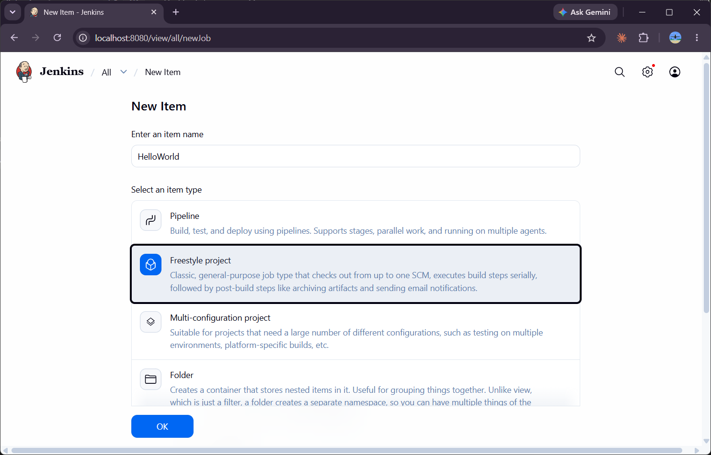
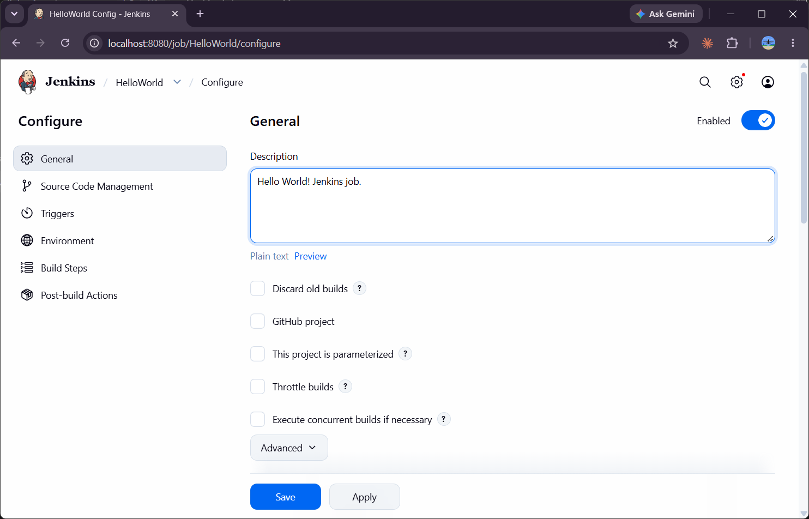
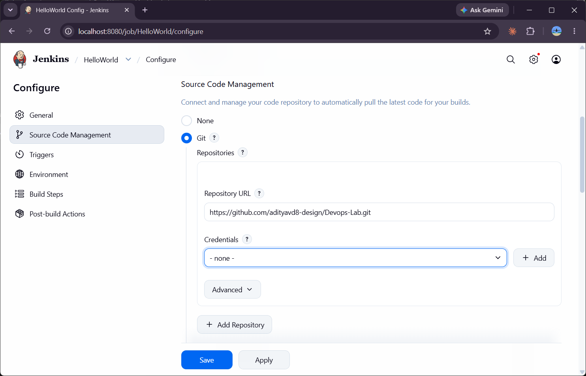
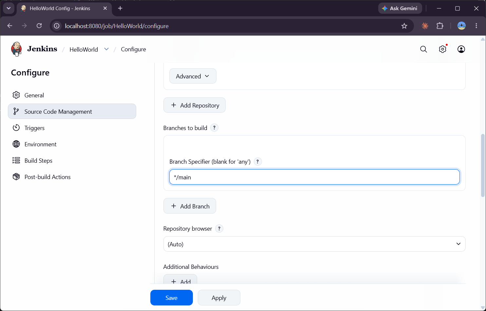
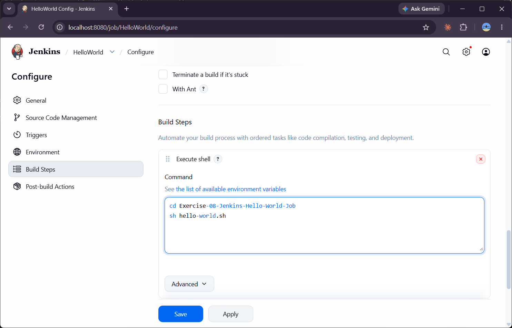
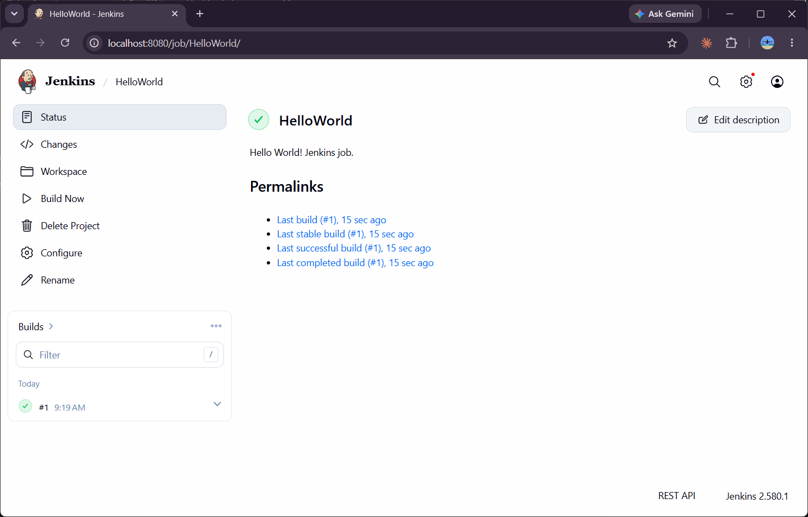
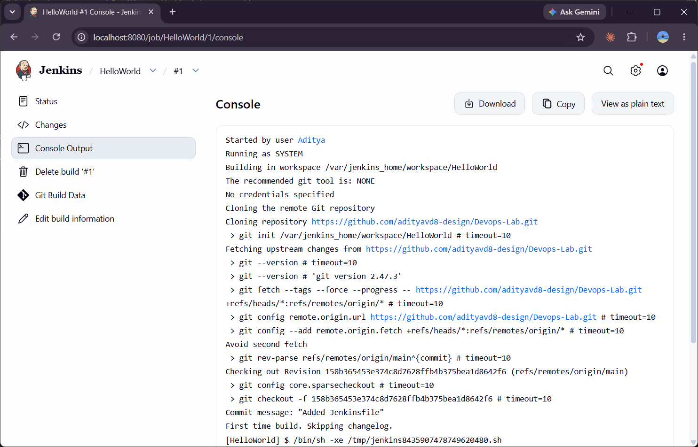
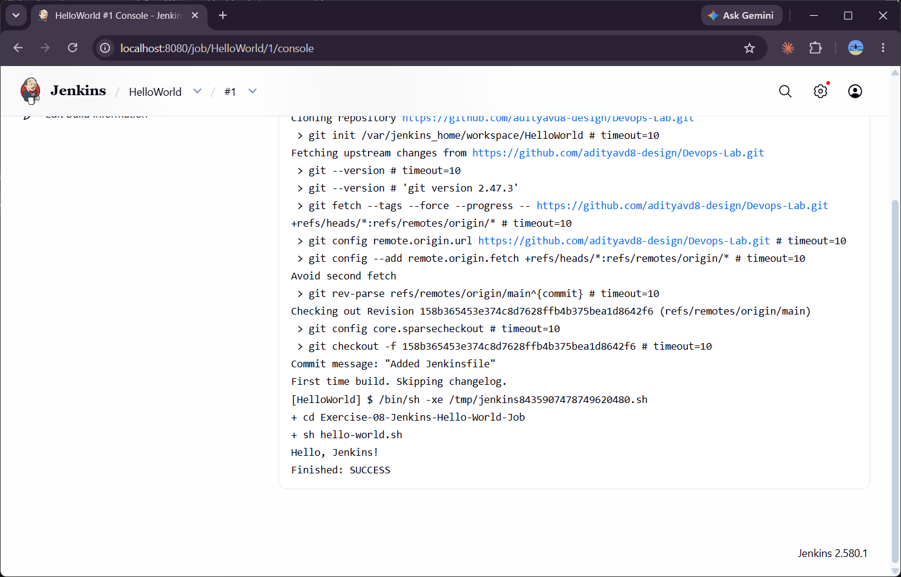

# Exercise 8 - Creating a "Hello World" Jenkins Job

## Aim
Create a shell script in GitHub and run it from a Jenkins Freestyle job.

## Files
| File | Description |
|------|-------------|
| [hello-world.sh](hello-world.sh) | Prints `Hello, Jenkins!` |



## Step 1 - Create the script and push it to GitHub
Instead of creating a separate `devops-sample-code` repository, I kept the script inside this same **Devops-Lab** repository (folder `Exercise-08-Jenkins-Hello-World-Job`) so that all the lab work is in one place. Git credentials are handled by Git Credential Manager (GitHub login in the browser) instead of typing a personal access token.

```bash
chmod +x hello-world.sh
cat hello-world.sh
./hello-world.sh
git add hello-world.sh
git status
git commit -m "Add hello-world.sh"
git push
```


## Step 2 - Create a new Freestyle job
Jenkins Dashboard → **New Item** → name `HelloWorld` → **Freestyle project** → OK



## Step 3 - Configure the job

### General - description
`Hello World! Jenkins job.`



### Source Code Management - Git
Repository URL: `https://github.com/adityavd8-design/Devops-Lab.git`



The default branch specifier is `*/master`, but my repository uses `main`, so I changed it to `*/main` (otherwise the checkout fails).



### Build Steps - Execute shell
```bash
cd Exercise-08-Jenkins-Hello-World-Job
sh hello-world.sh
```


## Step 4 - Save and Build Now


## Step 5 - Console Output
```
Started by user Aditya
Running as SYSTEM
Building in workspace /var/jenkins_home/workspace/HelloWorld
...
Cloning repository https://github.com/adityavd8-design/Devops-Lab.git
...
[HelloWorld] $ /bin/sh -xe /tmp/jenkins8435907478749620480.sh
+ cd Exercise-08-Jenkins-Hello-World-Job
+ sh hello-world.sh
Hello, Jenkins!
Finished: SUCCESS
```



## Conclusion
A Freestyle job was created in Jenkins that pulls the code from GitHub and runs `hello-world.sh`. Build #1 finished with **SUCCESS** and printed `Hello, Jenkins!`.
