# Exercise 9 - Jenkins Multi-Stage Pipeline: Deploying a Python Application

## Aim
Create and run a Jenkins Pipeline with multiple stages - **Build**, **Test**, **Deploy**, **Run Application** and **Test Application** - for a sample Python Flask application.

## Files
| File | Description |
|------|-------------|
| [python-flask-app/app.py](python-flask-app/app.py) | Flask app returning `Hello, Jenkins Multi-Stage Pipeline!` |
| [python-flask-app/requirements.txt](python-flask-app/requirements.txt) | flask |
| [python-flask-app/test_app.py](python-flask-app/test_app.py) | unittest for the `/` route |
| [python-flask-app/Jenkinsfile](python-flask-app/Jenkinsfile) | Declarative multi-stage pipeline |

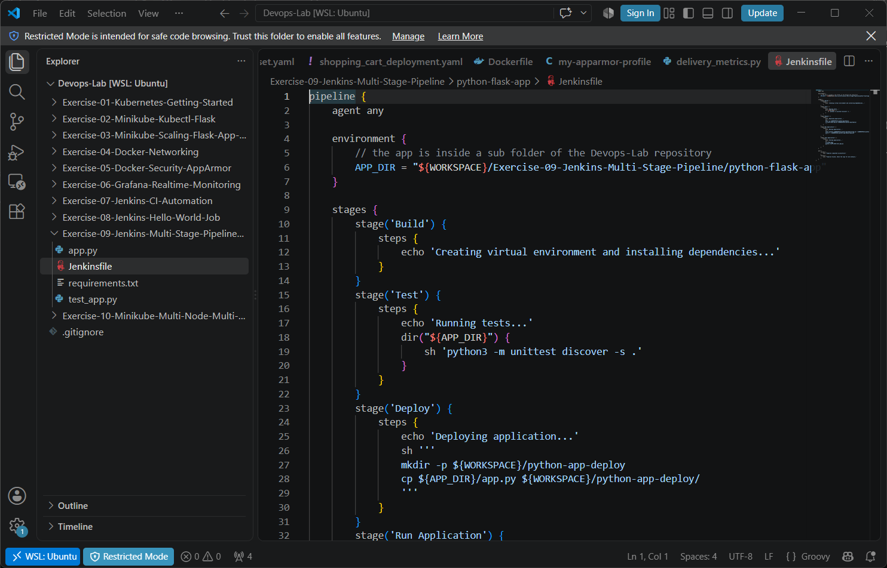

## Step 1 to 3 - Create the app and push it to GitHub
```bash
cd Exercise-09-Jenkins-Multi-Stage-Pipeline/python-flask-app
git add app.py requirements.txt test_app.py
git commit -m "Add python flask app and unit test for multi-stage pipeline"
git push
git add Jenkinsfile
git commit -m "Added Jenkinsfile"
git push
```
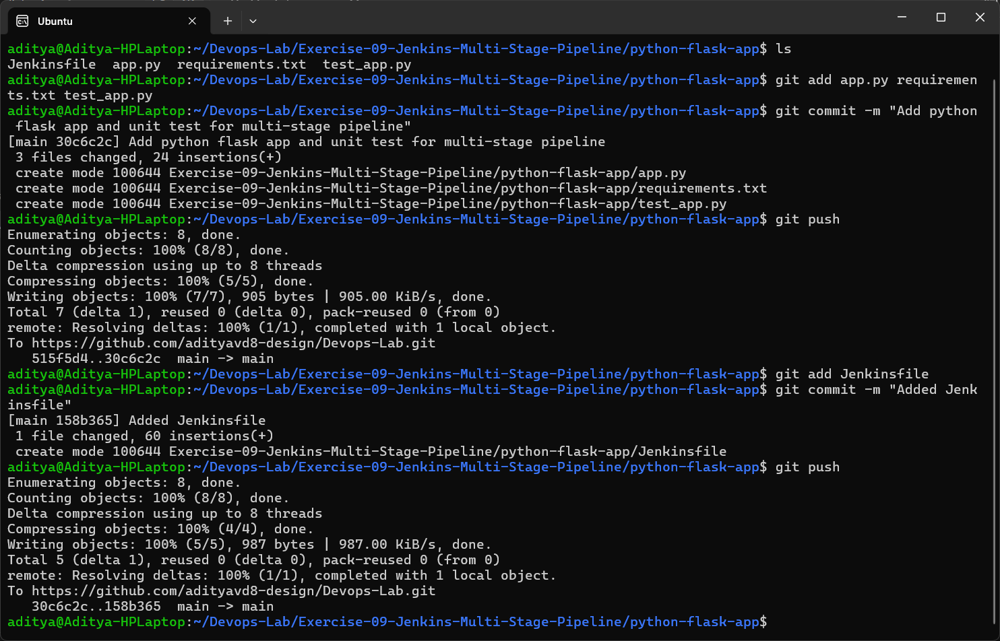

## Step 4 - Create the Pipeline job
New Item → `Python-MultiStage-Pipeline` → **Pipeline** → OK

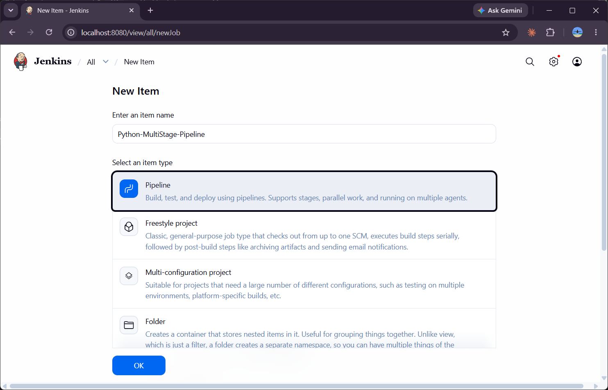

## Step 5 - Jenkinsfile
Since the app is inside a sub folder of the Devops-Lab repository (and not at the root like in the exercise), I added an `APP_DIR` environment variable and used it in the stages:

```groovy
environment {
    APP_DIR = "${WORKSPACE}/Exercise-09-Jenkins-Multi-Stage-Pipeline/python-flask-app"
}
```
The rest of the stages are the same as given in the exercise.

## Step 6 - Configure the job - Pipeline script from SCM
- Definition: **Pipeline script from SCM**
- SCM: **Git**, Repository URL: `https://github.com/adityavd8-design/Devops-Lab.git`
- Branch: `*/main`
- Script Path: `Exercise-09-Jenkins-Multi-Stage-Pipeline/python-flask-app/Jenkinsfile`

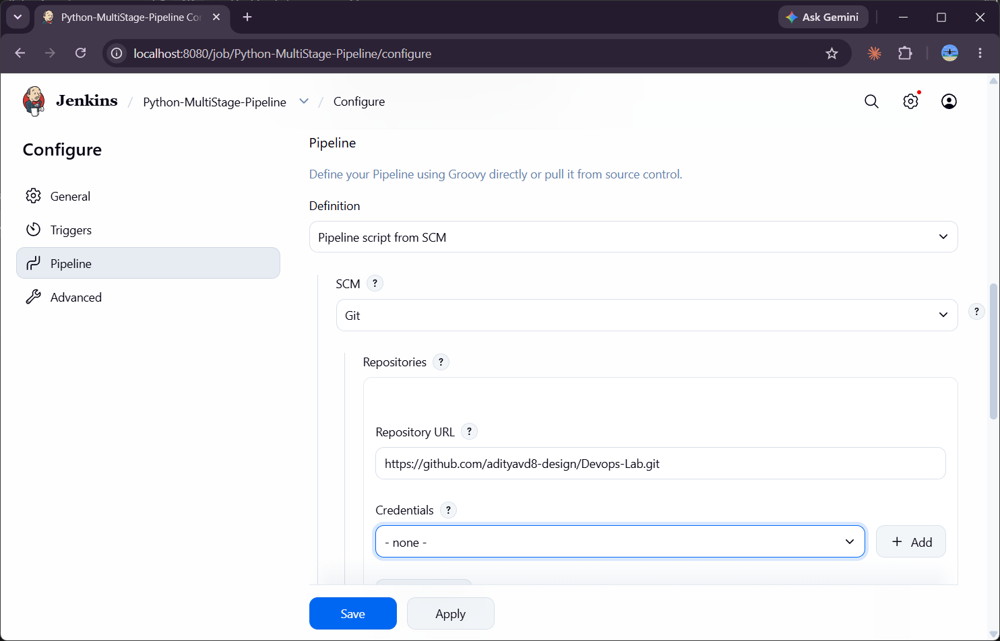
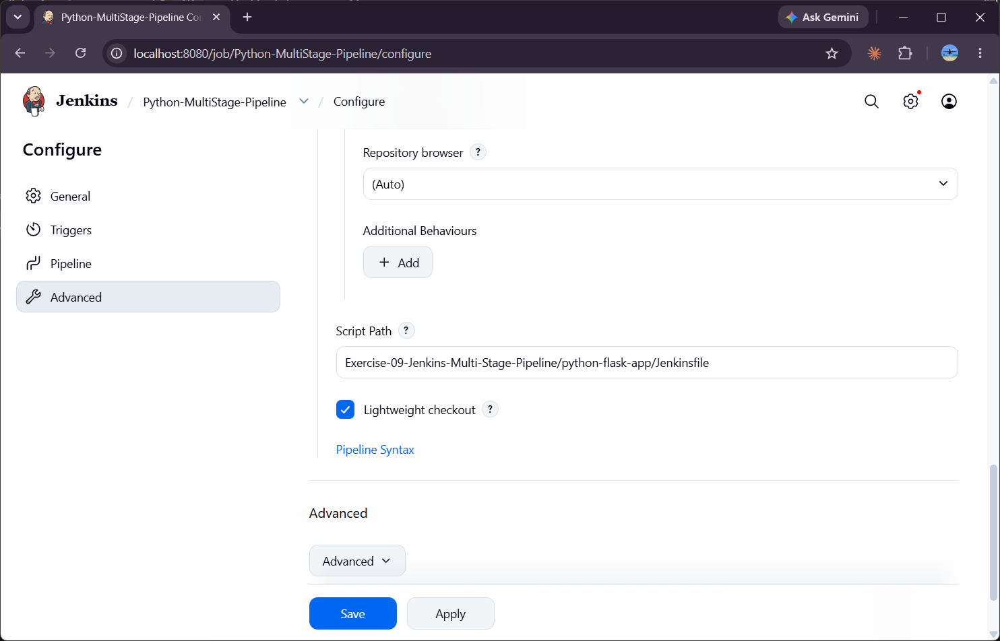

## Step 7 - First build (failed)
Build #1 failed in the **Test** stage:
```
+ python3 -m unittest discover -s .
.../script.sh.copy: 1: python3: not found
ERROR: script returned exit code 127
Finished: FAILURE
```
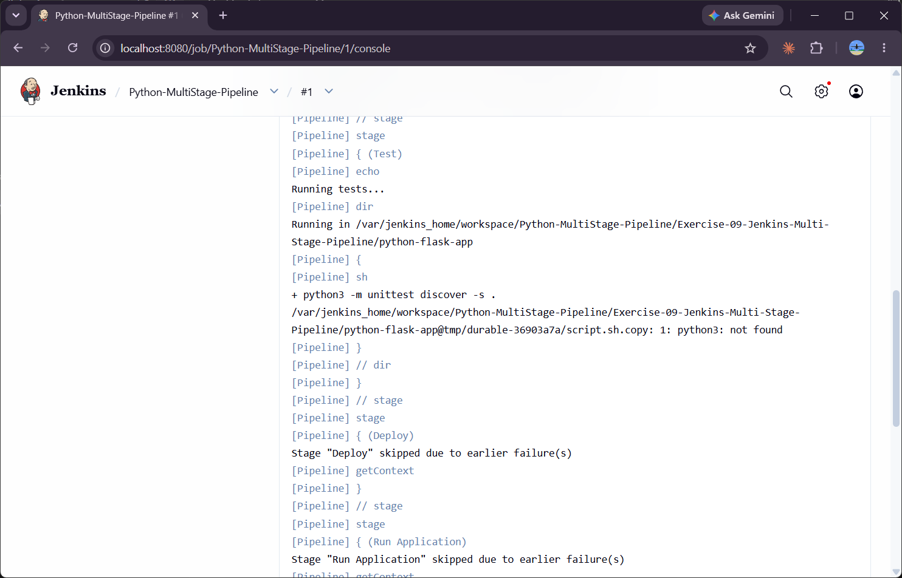
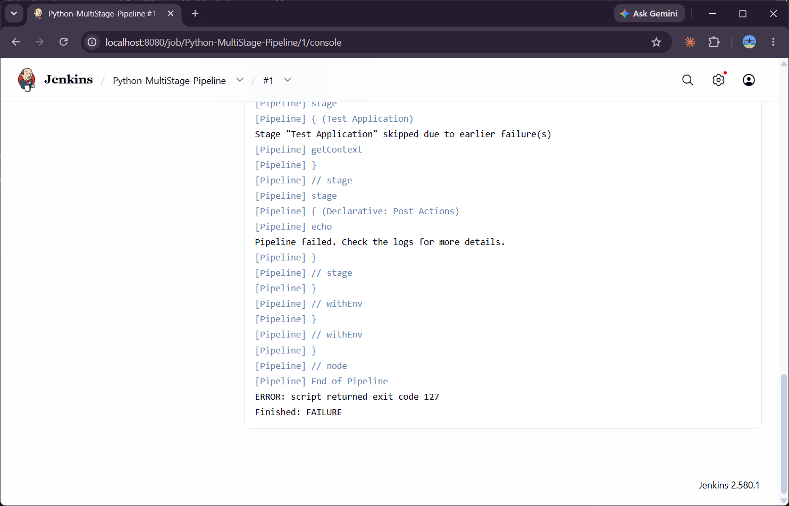

## Step 8 - Handling the build error
The `jenkins/jenkins:lts` image does not include Python, so I installed it inside the Jenkins container as root:
```bash
docker exec -u root jenkins bash -c "apt-get update && apt-get install -y python3 python3-pip python3-venv python3-flask"
```
The current Jenkins image is based on Debian 13, so the package is `python3` (Python 3.13) and `python3-flask` (Flask 3.1); `python3.11-venv` from the exercise is not available, `python3-venv` is used instead.

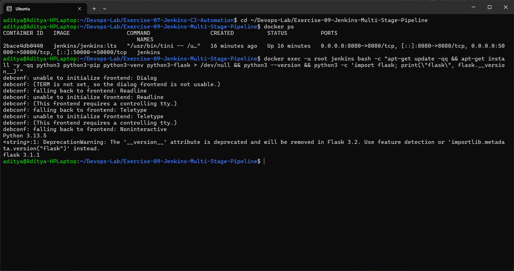

## Step 9 - Second build (success)
Clicked **Build Now** again and build #2 passed all the stages.

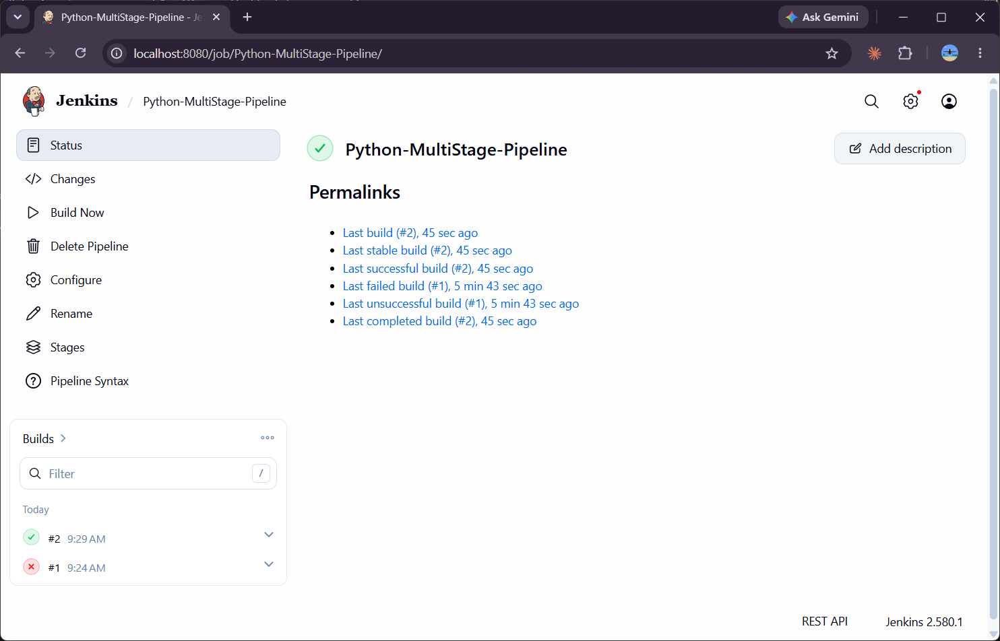

Stages view - build #1 failed at Test, build #2 passed everything:

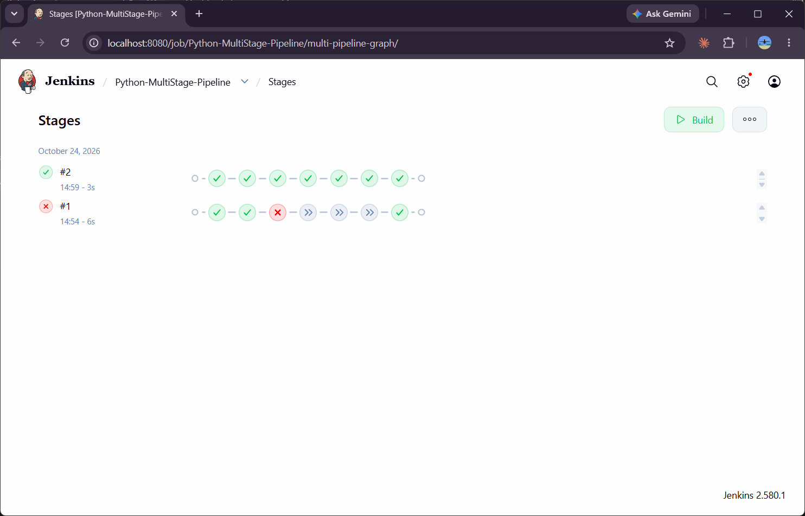

Pipeline overview of build #2 (Checkout SCM → Build → Test → Deploy → Run Application → Test Application → Post Actions):

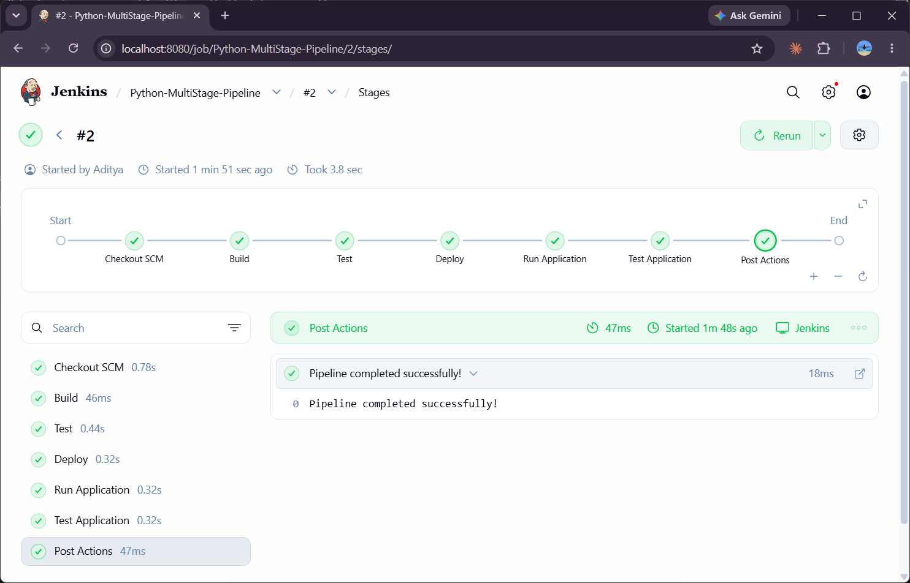

Console output - Deploy, Run Application and Test Application stages:

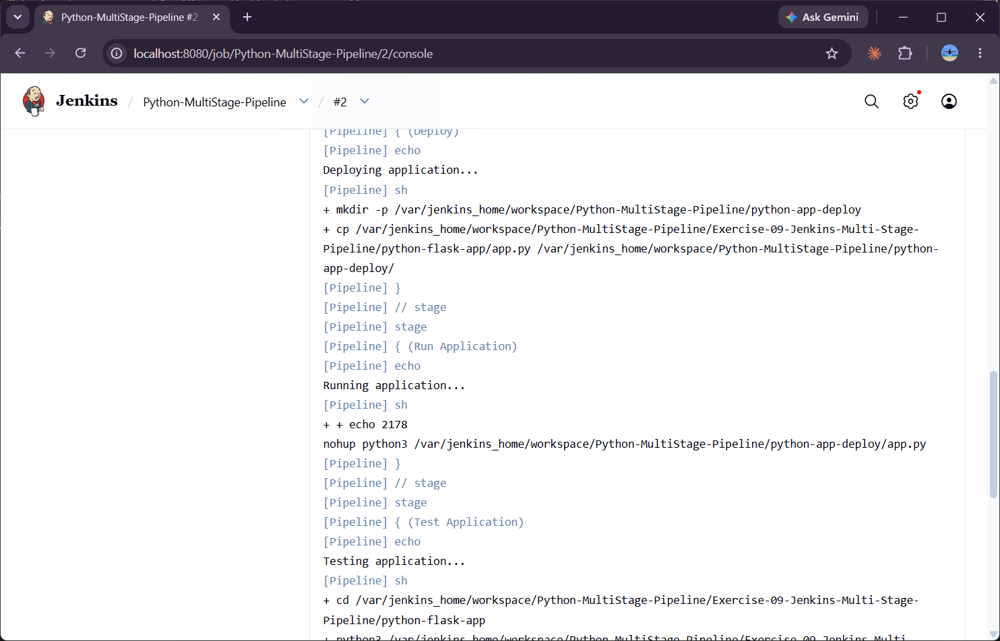

```
Ran 1 test in 0.004s

OK
Hello, Jenkins Multi-Stage Pipeline!
...
Pipeline completed successfully!
Finished: SUCCESS
```
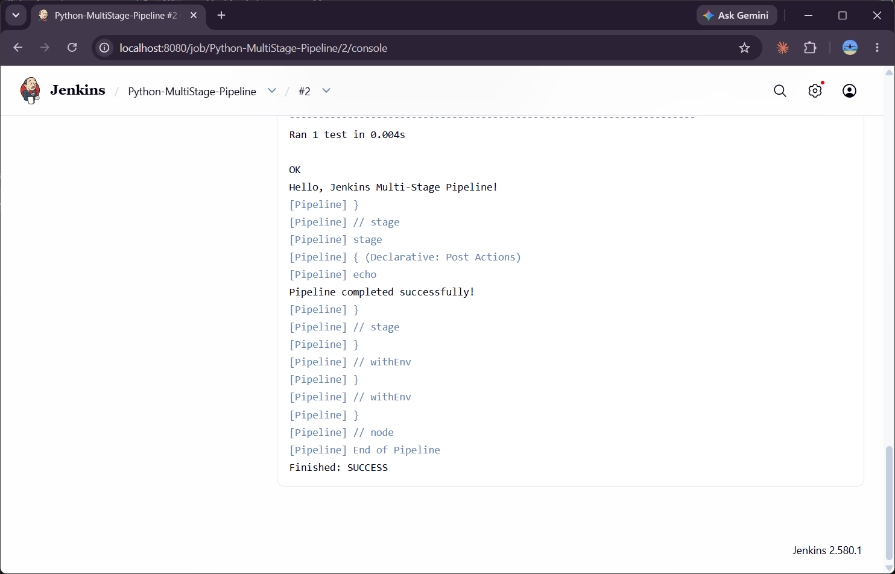

## Expected Outcome vs Result
| Stage | Result |
|-------|--------|
| Build | Echo step ran |
| Test | `unittest` ran 1 test - OK |
| Deploy | `app.py` copied to `$WORKSPACE/python-app-deploy` |
| Run Application | Flask app started in the background with `nohup` (PID saved in `app.pid`) |
| Test Application | `test_app.py` passed |
| Post | `Pipeline completed successfully!` |

## Conclusion
A multi-stage declarative pipeline was created using a Jenkinsfile stored in GitHub. The first run failed because Python was missing in the Jenkins container; after installing Python the pipeline completed all stages successfully.
