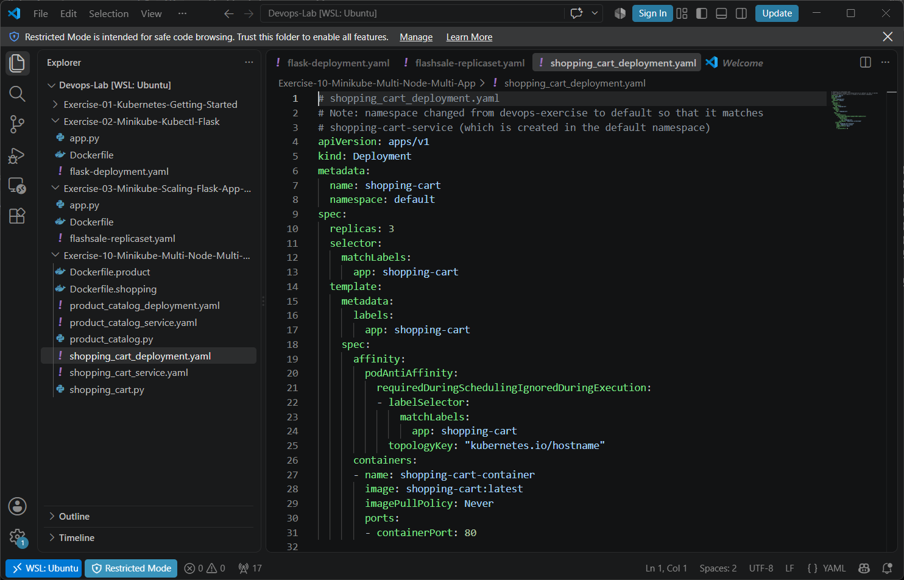
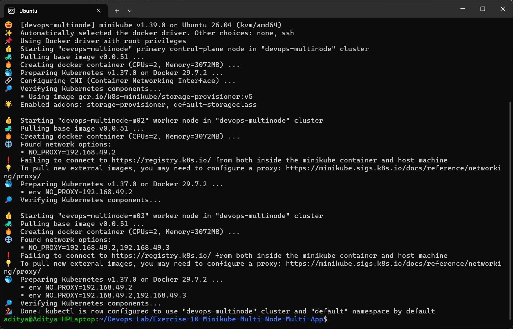
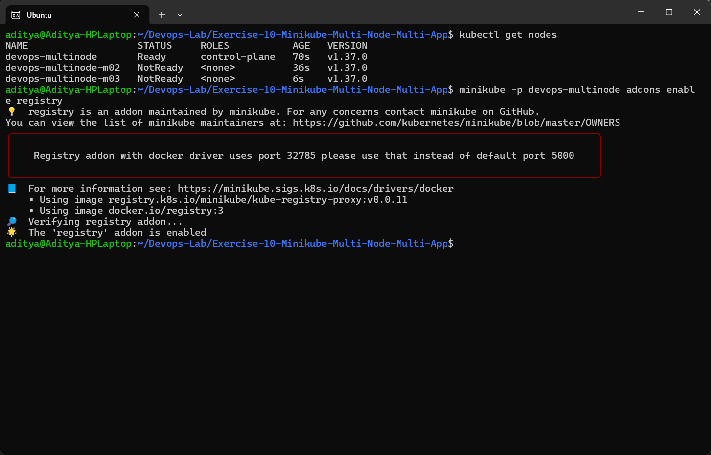
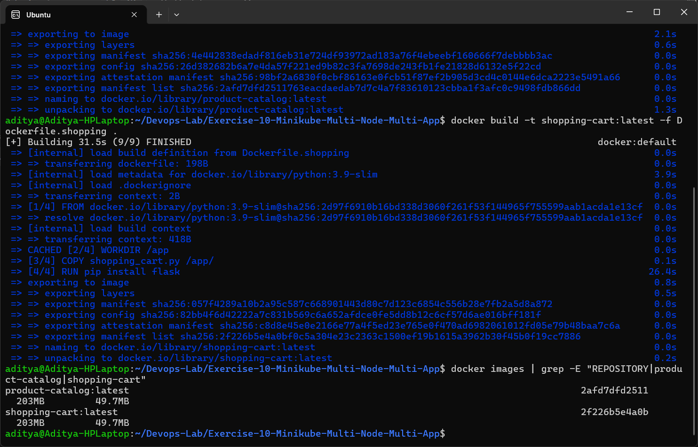
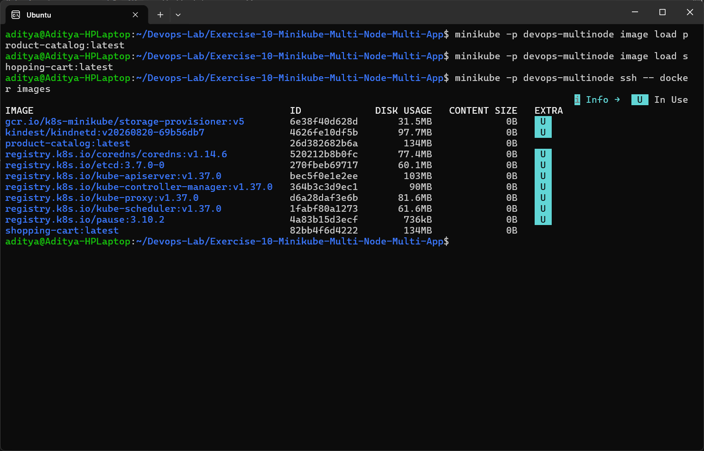
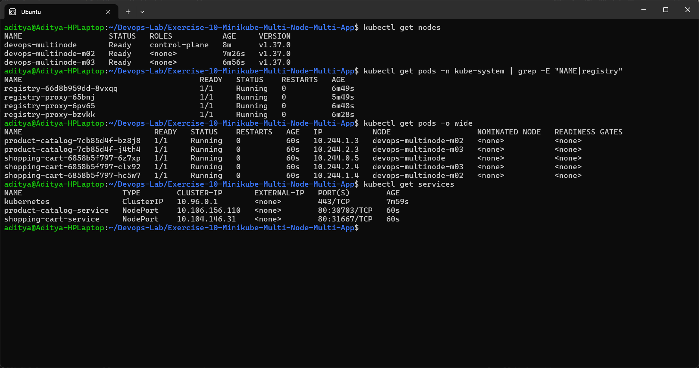
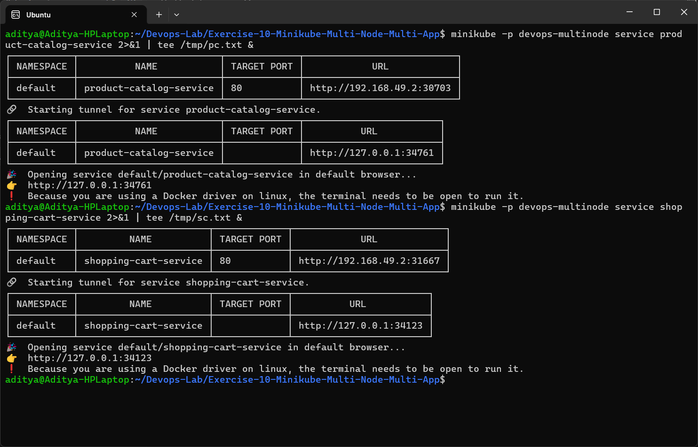
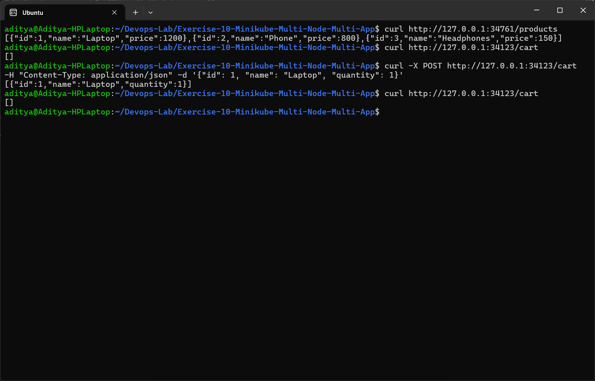
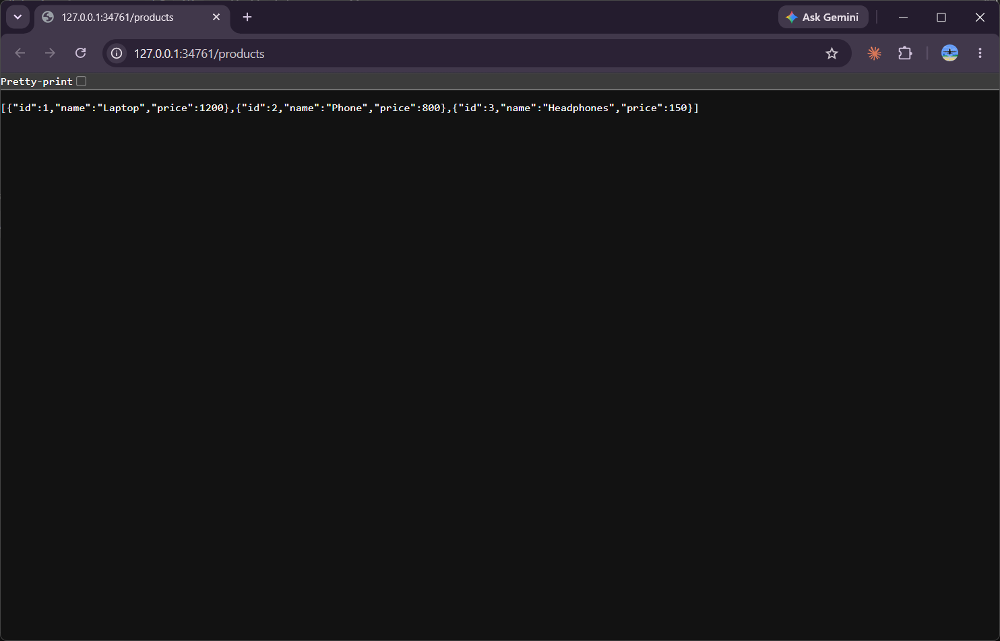
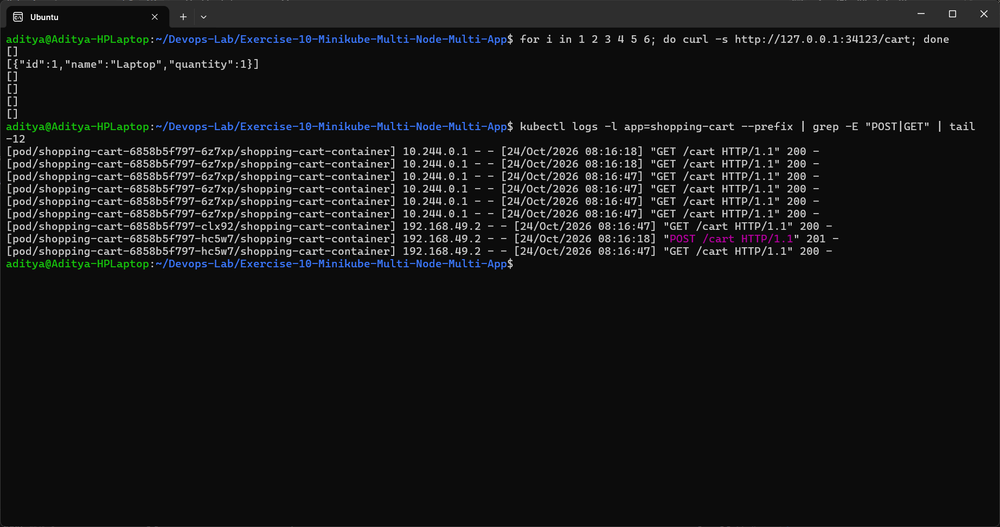

# Exercise 10 - Multi-Node Kubernetes Cluster with Multiple Applications and ReplicaSets

## Storyboard
An e-commerce platform with two services:
1. **Product Catalog** (AppA) - lists the available products - **2 replicas**
2. **Shopping Cart** (AppB) - manages the user cart - **3 replicas**

Each replica should run on a different node so that the services stay available even if a node fails.

## Files
| File | Description |
|------|-------------|
| [product_catalog.py](product_catalog.py) | Flask app - `GET /products` |
| [shopping_cart.py](shopping_cart.py) | Flask app - `GET /cart`, `POST /cart` |
| [Dockerfile.product](Dockerfile.product) | Image for product catalog |
| [Dockerfile.shopping](Dockerfile.shopping) | Image for shopping cart |
| [product_catalog_deployment.yaml](product_catalog_deployment.yaml) | Deployment, 2 replicas, pod anti-affinity |
| [shopping_cart_deployment.yaml](shopping_cart_deployment.yaml) | Deployment, 3 replicas, pod anti-affinity |
| [product_catalog_service.yaml](product_catalog_service.yaml) | NodePort service |
| [shopping_cart_service.yaml](shopping_cart_service.yaml) | NodePort service |



## Steps Performed

### Step 0 & 1a - Clean up and start a 3 node cluster
```bash
minikube stop
minikube delete
minikube start --nodes 3 -p devops-multinode
```
I ran this as a normal user (not root) so the `--force` flag was not needed.



### Step 1b - Enable the registry addon
```bash
minikube -p devops-multinode addons enable registry
```


### Step 2-4 - Build the images
```bash
docker build -t product-catalog:latest -f Dockerfile.product .
docker build -t shopping-cart:latest -f Dockerfile.shopping .
docker images
```


### Step 5 - Load the images into the cluster nodes
```bash
minikube -p devops-multinode image load product-catalog:latest
minikube -p devops-multinode image load shopping-cart:latest
minikube -p devops-multinode ssh -- docker images
```


### Step 6 & 7 - Deploy the apps and services
```bash
kubectl apply -f product_catalog_deployment.yaml
kubectl apply -f shopping_cart_deployment.yaml
kubectl apply -f product_catalog_service.yaml
kubectl apply -f shopping_cart_service.yaml
```

### Step 8 - Verify the distribution of pods
```bash
kubectl get nodes
kubectl get pods -n kube-system | grep registry
kubectl get pods -o wide
kubectl get services
```
- product-catalog pods → `devops-multinode-m02` and `devops-multinode-m03`
- shopping-cart pods → `devops-multinode`, `devops-multinode-m02` and `devops-multinode-m03`

Every replica of the same app is on a different node because of `podAntiAffinity` with `topologyKey: kubernetes.io/hostname`.



### Step 9 - Access the services
```bash
minikube -p devops-multinode service product-catalog-service
minikube -p devops-multinode service shopping-cart-service
```


### Step 10 - Test with curl
```bash
curl http://127.0.0.1:34761/products
curl http://127.0.0.1:34123/cart
curl -X POST http://127.0.0.1:34123/cart -H "Content-Type: application/json" -d '{"id": 1, "name": "Laptop", "quantity": 1}'
curl http://127.0.0.1:34123/cart
```


Product catalog in the browser:



## Observation - cart looks empty after adding an item
After the POST, the next `GET /cart` returned `[]`. I called `/cart` a few times and checked the pod logs:
```bash
for i in 1 2 3 4 5 6; do curl -s http://127.0.0.1:34123/cart; done
kubectl logs -l app=shopping-cart --prefix | grep -E "POST|GET" | tail -12
```


The POST went to pod `hc5w7` and only that pod has the item. The cart is stored in a Python list in memory, so each of the 3 replicas has its own separate cart, and the Service sends each request to any one of the pods. In a real system the cart should be stored in a shared store like Redis or a database so that all replicas see the same data.

## Issues Faced / Changes Made
1. `shopping_cart_deployment.yaml` used `namespace: devops-exercise` but the service is in `default`, so the service would never find the pods (and the namespace did not exist). I changed the deployment namespace to `default`.
2. Right after `minikube start` the worker nodes showed `NotReady` for a short time; I waited until all three were `Ready` before deploying.

## Summary
Two Python applications were deployed on a 3 node Minikube cluster. Product Catalog runs 2 replicas and Shopping Cart runs 3 replicas, and anti-affinity made sure each replica is on a different node, which improves availability and fault tolerance.
